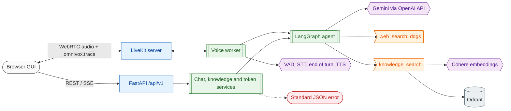
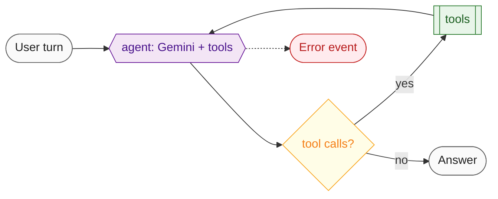

# OmniVox

A real-time voice agent. You talk to it in the browser; LiveKit carries the audio; VAD, streaming speech-to-text and an end-of-turn model decide when you are done; a LangGraph agent (Gemini through an OpenAI-compatible API) answers, searching the web with ddgs or your own documents in Qdrant; streaming text-to-speech talks back. A web GUI shows the call and an Inspector that exposes every internal step.



Legend: stadium = client or response, rectangle = route or server, subroutine = service, hexagon = model, flag = tool or external API, cylinder = storage, dashed = error path.

The agent graph (details in [docs/graph.md](docs/graph.md)):



## Quick start

```bash
make install && make env       # then fill in the keys in .env
make up                        # everything in Docker: LiveKit, Qdrant, API, agent, GUI on http://localhost:8080
```

Or develop locally with only LiveKit and Qdrant in Docker:

```bash
make docker-infra-up           # LiveKit and Qdrant
make run                       # API on http://localhost:8100, in one terminal
make agent                     # voice worker, in a second terminal
make frontend-install && make frontend-dev   # GUI on http://localhost:5173
```

No `make` (Windows)? See [docs/installation.md](docs/installation.md).

## Project structure

```text
omnivox/
├── pyproject.toml                       dependencies (uv), ruff and pytest config
├── requirements.txt                     pinned runtime dependencies (Docker, make deploy-app)
├── .env  .env.example                   secrets (git-ignored) and every variable, documented
├── Makefile  LICENSE  README.md
│
├── config/
│   ├── settings.py                      Pydantic Settings and the cached get_settings()
│   └── logger.py                        colored console, rotating file, request id, secret redaction
│
├── src/
│   ├── app.py                           create_app() and the `python -m src.app` entry point
│   ├── composition.py                   wiring shared by the API and the voice worker
│   ├── api/
│   │   ├── deps.py                      API composition root: container, auth, Depends
│   │   ├── middleware.py                request id, access log, CORS, body size limit
│   │   ├── error_handlers.py            domain errors to the JSON error body
│   │   ├── routes/                      health, info, livekit, knowledge, graph/agent
│   │   └── schemas/                     requests (bounded, extra forbidden), responses, ErrorResponse
│   ├── services/                        chat, knowledge and LiveKit token use cases, framework-free
│   ├── graph/                           LangGraph agent: builder, state, memory, streaming, trace
│   │   ├── nodes/                       agent, tools
│   │   └── tools/                       knowledge_search, web_search
│   ├── ai_models/                       the only code that builds model clients (LLM, embeddings, STT, TTS, VAD, turn, tracing)
│   ├── rag/                             document loaders and the retriever
│   ├── clients/                         Qdrant and web search (ddgs) wrappers
│   ├── voice/                           LiveKit worker, session, speech filter, Inspector
│   ├── prompts/                         all prompt text and PROMPT_VERSION
│   └── utils/                           domain errors, data models, text helpers, trace events
│
├── tests/                               mirrors src/; conftest.py (settings, client) and fakes.py (scripted model)
├── frontend/                            React + TypeScript console (Vite)
│   └── src/                             views, components, inspector, state, hooks, api, styles
├── deployment/
│   ├── Dockerfile  Dockerfile.frontend  API and worker image, GUI image
│   ├── docker-compose.yml               profiles app, gui and infra
│   ├── nginx/                           site template
│   └── systemd/                         API, voice agent and Docker stack units
├── docs/                                reference pages, blocks/ study guide, api_integration/ Postman and schemas
└── files/logs/                          runtime logs (git-ignored)
```

## Documentation

| Document | What it covers |
| --- | --- |
| [Study guide](docs/blocks/README.md) | One page per block (graph, LiveKit, frontend, infrastructure and more) for learning the code |
| [Installation](docs/installation.md) | Prerequisites, `uv`, keys, the Windows command table |
| [Running](docs/running.md) | Docker, local development and systemd, step by step |
| [Configuration](docs/config.md) | Every environment variable with type, default and meaning |
| [API](docs/api.md) | Endpoints, auth, request and response examples, errors, SSE events |
| [Voice and Inspector](docs/voice.md) | The LiveKit pipeline and the internal-steps Inspector |
| [Graph](docs/graph.md) | Agent graph: state, nodes, tools, memory, stream events |
| [Models and tracing](docs/llm.md) | LLM, embeddings, speech models, thinking control, tracing |
| [Prompts](docs/prompts.md) | Each prompt with purpose, variables, version and contract |
| [Helpers](docs/utils.md) | Catalog of the pure helpers and domain errors |
| [Features and assumptions](docs/features.md) | Features, limits and the assumptions made |
| [Deployment](docs/deployment.md) | Compose profiles, systemd, nginx and every Makefile target |
| [GUI](docs/frontend.md) | The React console: structure, theming, development |
| [Postman collection](docs/api_integration/collections/collection.json) | Importable collection for Postman, Bruno and Insomnia |
