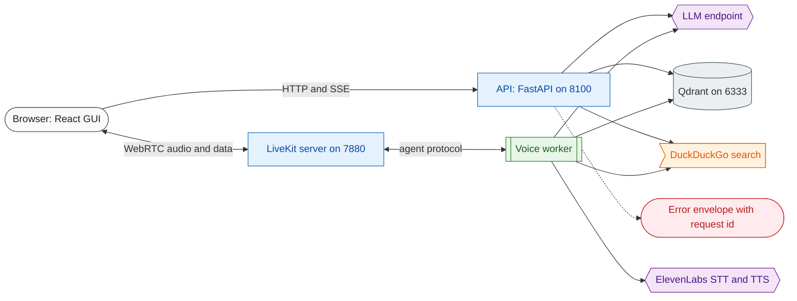
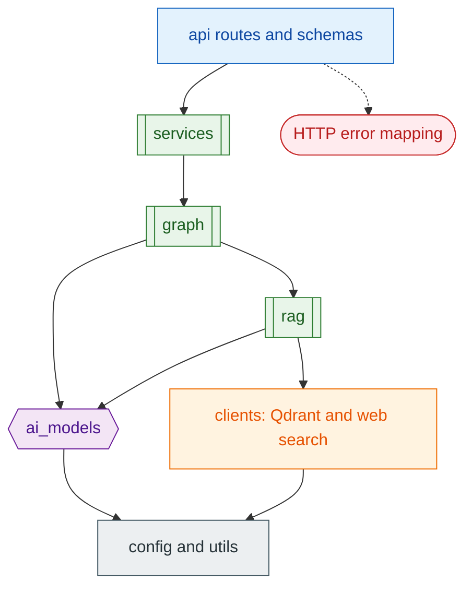
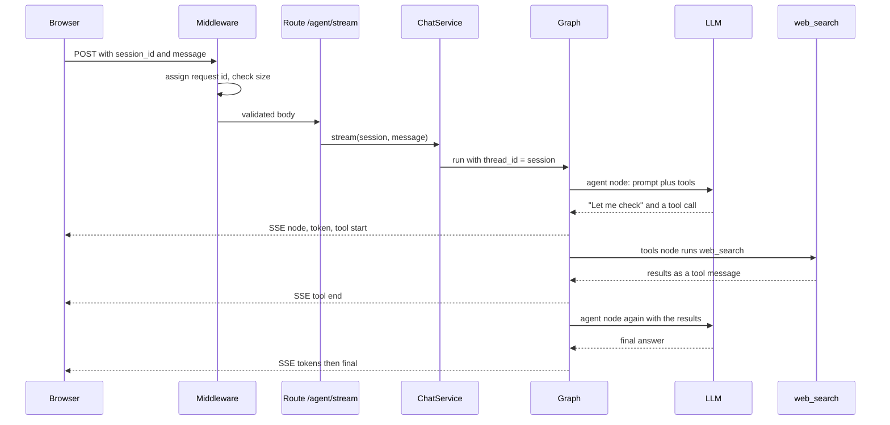
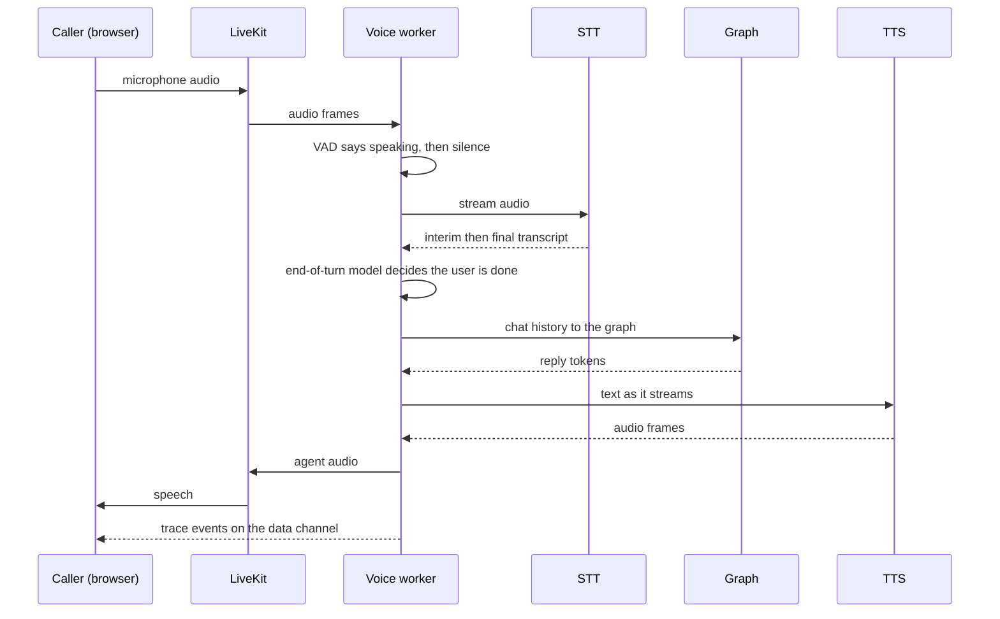

# 01 System map

**What this page is:** the whole system on one page. Read it first, or whenever you lose the thread. **Assumes:** nothing.

## 1. The processes

OmniVox is not one program. A working call involves these processes, each of which you can start and stop on its own:



| Process | Started by | Port | Job |
| --- | --- | --- | --- |
| API | `make run` (`python -m src.app`) | 8100 | text chat, knowledge base upload and search, LiveKit tokens, health |
| Voice worker | `make agent` (`python -m src.voice.worker start`) | 8181 (health only) | joins each room and runs the voice pipeline |
| LiveKit server | docker compose | 7880 signaling, 7881 TCP and 7882 UDP media | moves audio between the browser and the worker |
| GUI | `make frontend-dev` | 5173 | the web app; proxies `/api` to the API in development |
| Qdrant | a container in `make up` and `make docker-infra-up`, or your own | 6333 | vector database for the knowledge base |

The API and the worker share **code** (the graph, the models, the knowledge base) but not **memory**: they are separate processes that each build their own copy of the agent. That is why [block 02](02-configuration-and-logging.md) matters: both read the same `.env`.

## 2. Layers inside the Python code

Imports only point downward. A layer may use the ones below it and never the ones above:



`src/voice/` sits beside `src/api/` as a second entry point. Both are "composition roots": the only places that create the real objects and hand them to everything else. Tests replace those objects with fakes ([block 13](13-testing.md)). The rule is that imports point downward only: routes call services, services call the graph and the model layer, never the reverse.

## 3. Walkthrough A: one text message

The user types "search the web for X" in the Chat view.



What to notice: the model is called **twice** (once to decide to search, once to answer), the browser sees progress as it happens, and the same session id means the second message remembers the first ([block 06](06-agent-graph.md), memory).

## 4. Walkthrough B: one spoken question



The last arrow is the Inspector ([block 11](11-inspector.md)). Everything between "audio frames" and "agent audio" happens inside `AgentSession` ([block 10](10-voice-worker.md)).

## 5. Where the time goes

Measured in a live run with ElevenLabs and the local turn model (numbers vary by network and model):

| Stage | Typical time | Controlled by |
| --- | --- | --- |
| Speech to first interim transcript | about 0.8 s after speech starts | the STT model |
| Silence to "user is done" | 0.5 to 3 s (0.85 s observed) | `MIN_ENDPOINTING_DELAY`, `MAX_ENDPOINTING_DELAY`, the turn model |
| LLM first token | 0.3 to 0.6 s | the model, thinking on or off |
| A web search | 2.8 to 4.5 s | DuckDuckGo, `WEB_SEARCH_TIMEOUT` |
| A knowledge-base search | about 0.4 s | Cohere plus Qdrant |
| TTS first audio | 0.17 s | the TTS model |
| Whole turn, no tool | about 2 to 3.5 s from the end of speech | all of the above |

The model says "Let me check" before it calls a tool, so the caller hears something while the slow tool runs.

## 6. Repository map

```text
config/         settings and logging                     block 02
src/app.py      app factory                              block 03
src/api/        routes, schemas, middleware, errors      block 03
src/services/   use cases                                block 04
src/ai_models/  model clients                            block 05
src/graph/      the agent                                blocks 06 and 07
src/prompts/    all prompt text                          block 07
src/rag/        knowledge base logic                     block 08
src/clients/    Qdrant and web search wrappers           block 08
src/voice/      the LiveKit worker and Inspector         blocks 10 and 11
frontend/       the web app                              block 12
tests/          offline tests                            block 13
deployment/     Docker, nginx, systemd; Makefile         block 14
```

## Try it

1. Start only the API (`make run`) and call `GET /health`, then `POST /api/v1/agent/invoke` with `curl -X POST localhost:8100/api/v1/agent/invoke -H "Content-Type: application/json" -d '{"session_id":"s1","message":"What is the capital of France?"}'`. You have just exercised Walkthrough A without a browser.
2. Open `files/logs/omnivox.log` and find the lines of that request: they all carry the same request id.

## Check yourself

- Why does a text question that uses a tool cost two LLM calls?
- Which two processes need the same `.env`, and why does neither import the other?
- In Walkthrough B, which arrow carries the Inspector's events, and does it go through the API process?

## Read next

[03 API layer](03-api-layer.md) for the text path or [09 LiveKit](09-livekit.md) for the voice path.
