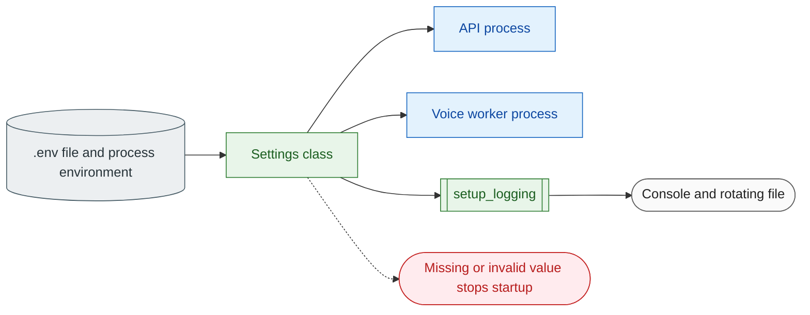

# 02 Configuration and logging

**What this block is:** the two modules every other block depends on: `config/settings.py` (typed settings from the environment) and `config/logger.py` (formatted, redacted logs). **Assumes:** basic Python. **Reference table of every variable:** [config.md](../config.md).

## 1. The problem

A voice agent needs a dozen secrets and a few dozen knobs (model names, timeouts, thresholds). Done badly you get three classic failures: a typo in a variable name is silently ignored, a secret ends up in a log line, and the API and the worker disagree about a value. This block removes all three.



## 2. Settings, step by step

1. `Settings` is a Pydantic `BaseSettings`. Each field name **is** the environment variable name (`OPENAI_MODEL`, `PORT`, ...).
2. Values come from the process environment first, then from `.env` in the working directory. `env_ignore_empty=True` means a blank `KEY=` line counts as "not set", so the default applies. That is why `.env.example` can list every variable, with blanks for optional ones.
3. Types do the validation: `PORT` is an integer between 1 and 65535, `STT_PROVIDER` is a `Literal["elevenlabs", "openai"]`, secrets are `SecretStr`. Anything wrong stops the process at startup with a message naming the field.
4. A `model_validator` checks rules that involve several fields (for example `RAG_CHUNK_OVERLAP` must be smaller than `RAG_CHUNK_SIZE`).
5. `get_settings()` is cached, so every module sees the same object.

```python
# config/settings.py (Settings._check_consistency)
def _check_consistency(self) -> "Settings":
    if not self.API_PREFIX.startswith("/"):
        raise ValueError("API_PREFIX must start with '/'")
    if self.ROOT_PATH and not self.ROOT_PATH.startswith("/"):
        raise ValueError("ROOT_PATH must be empty or start with '/'")
    if self.RAG_CHUNK_OVERLAP >= self.RAG_CHUNK_SIZE:
        raise ValueError("RAG_CHUNK_OVERLAP must be smaller than RAG_CHUNK_SIZE")
    if self.MIN_ENDPOINTING_DELAY > self.MAX_ENDPOINTING_DELAY:
        raise ValueError("MIN_ENDPOINTING_DELAY must not exceed MAX_ENDPOINTING_DELAY")
    if self.TRACING_PROVIDER == "langsmith" and self.LANGSMITH_API_KEY is None:
        raise ValueError("TRACING_PROVIDER=langsmith requires LANGSMITH_API_KEY")
    return self
```

```python
# config/settings.py
def get_settings() -> Settings:
    """Return the cached settings; raises ``ValidationError`` listing every missing value."""
    return Settings()
```

`SecretStr` hides the value in `repr()`, in `model_dump()` and in tracebacks; you must call `.get_secret_value()` to read it, which makes accidental printing a visible act. `Settings.secret_values()` collects every secret so the logger can mask them:

```python
# config/settings.py (Settings.secret_values)
def secret_values(self) -> list[str]:
    """Every non-empty secret value, used to mask log output."""
    values: list[str] = []
    for name in type(self).model_fields:
        value = getattr(self, name)
        if isinstance(value, SecretStr) and value.get_secret_value():
            values.extend(
                part for part in value.get_secret_value().split(",") if len(part.strip()) >= 8
            )
    return values
```

### Three things that look odd but are deliberate

- **Required fields have no default.** `OPENAI_API_KEY` (for the default Gemini endpoint) and `LIVEKIT_API_SECRET` fail startup if missing, so a typo cannot produce a half-working service. A validator on `OPENAI_API_KEY` looks at `OPENAI_BASE_URL`: with a custom endpoint such as a vLLM server the key may stay blank, and a placeholder key is sent because the OpenAI client refuses an empty one.
- **Optional features stay optional.** `EMBEDDING_API_KEY` and `ELEVENLABS_API_KEY` may be empty: the API still starts, and the feature that needs them reports `service_not_configured` when used (block [08](08-knowledge-base-rag.md)). The embeddings count as configured without a key when `EMBEDDING_BASE_URL` is not the default Cohere endpoint.
- **The parity test.** `tests/config/test_settings.py` fails when a `Settings` field is missing from `.env.example` (or the other way round). It also fails if `.env.example` stops being a plain `KEY=VALUE` file, because the same file must work for Pydantic, Docker Compose and systemd, which parse quotes and inline comments differently.

## 3. Logging, step by step

`setup_logging(settings)` is called by `create_app` and by the worker. It:

1. removes any handler it installed before, then installs a console handler and a rotating file handler (`files/logs/omnivox.log`), so calling it twice never doubles every line;
2. picks the format: colored lines for a terminal, or JSON when `LOG_FORMAT=json`;
3. points uvicorn and LiveKit loggers at the same handlers and quiets the chatty ones (`httpx`, `openai`, `ddgs`, `qdrant_client`) to WARNING unless `LOG_LEVEL=DEBUG`;
4. registers every secret value for masking.

```python
# config/logger.py
def setup_logging(settings: Settings, *, exclusive: bool = False) -> None:
    """Configure the root logger; calling it again replaces our handlers, never stacks them.

    ``exclusive`` also removes handlers installed by other libraries (the LiveKit CLI does so).
    """
    _exact_secrets.update(settings.secret_values())
    root = logging.getLogger()
    for handler in list(root.handlers):
        if exclusive or getattr(handler, HANDLER_MARK, False):
            root.removeHandler(handler)
            handler.close()

    console = _mark(logging.StreamHandler(sys.stderr))
    if settings.LOG_FORMAT == "json":
        console.setFormatter(JsonFormatter())
    else:
        console.setFormatter(ConsoleFormatter(_supports_color(sys.stderr)))
    root.addHandler(console)

    log_dir = Path(settings.LOG_DIR)
    log_dir.mkdir(parents=True, exist_ok=True)
    file_handler = _mark(
        RotatingFileHandler(
            log_dir / LOG_FILE_NAME,
            maxBytes=settings.LOG_MAX_BYTES,
            backupCount=settings.LOG_BACKUP_COUNT,
            encoding="utf-8",
        )
    )
    file_handler.setFormatter(JsonFormatter() if settings.LOG_FORMAT == "json" else FileFormatter())
    root.addHandler(file_handler)
    root.setLevel(settings.LOG_LEVEL)

    for name in ROUTED_LOGGERS:
        routed = logging.getLogger(name)
        routed.handlers.clear()
        routed.propagate = True
    logging.getLogger("uvicorn.access").setLevel(logging.WARNING)
    quiet_level = logging.DEBUG if settings.LOG_LEVEL == "DEBUG" else logging.WARNING
    for name in NOISY_LOGGERS:
        logging.getLogger(name).setLevel(quiet_level)
```

The line format is `timestamp | level | logger | request_id | message`. The request id comes from a `contextvar`: the API middleware sets it for each request, the voice worker sets it to the room name, and every log call made while that context is active carries it. That is how you find all log lines of one request.

### Redaction happens in the formatter

A filter on a handler only sees the log message. A traceback is formatted later, so a key inside an exception message would slip through. The formatter masks the **final text**, tracebacks included:

```python
# config/logger.py
def redact(text: str) -> str:
    """Mask known secret values and secret-looking tokens in ``text``."""
    for secret in _exact_secrets:
        text = text.replace(secret, REDACTED)
    for pattern in SECRET_PATTERNS:
        text = pattern.sub(_mask_match, text)
    return text
```

```python
# config/logger.py
SECRET_PATTERNS = (
    re.compile(r"AIza[0-9A-Za-z_\-]{30,}"),
    re.compile(r"lsv2_[A-Za-z0-9_]{20,}"),
    re.compile(r"\bsk[-_][A-Za-z0-9_\-]{16,}"),
    re.compile(r"(?i)bearer\s+[A-Za-z0-9._\-]{8,}"),
    re.compile(r"(?i)(xi-api-key|x-api-key|api[_-]?key)(\"?\s*[:=]\s*\"?)[^\s\"',}]{6,}"),
    re.compile(r"\beyJ[A-Za-z0-9_\-]{8,}\.[A-Za-z0-9_\-]{8,}\.[A-Za-z0-9_\-]{8,}"),
    re.compile(r"\b[0-9a-f]{64}\b"),
)
```

Two layers work together: exact secret values registered at startup, and regular expressions for secret-shaped text (Google `AIza...` keys, LangSmith `lsv2_...`, `sk-` keys, bearer tokens, LiveKit JWTs, 64-hex strings).

## 4. Mistakes that happened here (learn from them)

| What happened | Why | Fix |
| --- | --- | --- |
| A rewrite of `.env` dropped a key the user had just added | the script rebuilt the file from `.env.example` and only carried over keys it knew | never rebuild `.env`; change single lines |
| `localhost:8000` answered with someone else's page | another application listened on 8000 | default port is 8100; check with `netstat` first |
| Two log lines for each event under the LiveKit CLI | the CLI installs its own handler | `setup_logging(settings, exclusive=True)` in the worker removes foreign handlers |
| The Inspector showed `httpx2` noise | the OpenAI SDK logs under another logger name | add the name to `NOISY_LOGGERS` |

## 5. Rules of thumb

- Above DEBUG, log **sizes and ids, never prompts, transcripts or documents**.
- Add a setting in four places: `config/settings.py`, `.env.example` (with a comment line above it), `docs/config.md` (one table row per setting; `tests/config/test_settings.py` checks `.env.example` against `Settings`), and use it through `settings`, never `os.environ`.
- In tests build settings with `Settings(_env_file=None, ...)` so your real `.env` cannot leak in ([block 13](13-testing.md)).

## Try it

```bash
uv run python -c "from config.settings import get_settings; s = get_settings(); print(s.OPENAI_MODEL, s.PORT); print(repr(s.OPENAI_API_KEY))"
uv run python -c "from config.logger import redact; print(redact('key=AIza' + 'x'*35 + ' and Bearer abc.def-123456'))"
```

The first prints the model and a masked key. The second prints `***` in place of both secrets. Now set `PORT=0` in a copy of `.env` and start the API: it refuses to start and names `PORT`.

## Check yourself

- Why is `env_ignore_empty=True` needed for `.env.example` to double as a template?
- Where in the pipeline would a secret leak if redaction were a log *filter* instead of part of the *formatter*?
- You add `FOO_TIMEOUT`. Which four things must you touch, and which test tells you if you forgot one?

## Read next

[03 API layer](03-api-layer.md), which uses the request id; or [13 Testing](13-testing.md) for the parity and doc tests.
