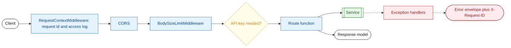

# 03 API layer

**What this block is:** the HTTP side: the app factory (`src/app.py`), middleware, error handling, dependency wiring (`src/api/deps.py`), routes and request/response models. **Assumes:** [02](02-configuration-and-logging.md) (request id, settings). **Endpoint reference:** [api.md](../api.md).

## 1. The problem

A web layer is easy to write and easy to get subtly wrong: errors leak stack traces, a big body exhausts memory, a failing request cannot be matched with its log lines, tests cannot replace the model. This block is thin on purpose: it parses, calls a service, and shapes the response. All logic lives below it ([block 04](04-services.md)).



## 2. The app factory

`create_app(settings, container_factory=build_container)` builds everything and returns a FastAPI app. Heavy work (creating clients, compiling the graph) happens in the **lifespan**, not at import time, and is undone on shutdown through an `AsyncExitStack`:

```python
# src/app.py
def create_app(
    settings: Settings | None = None, *, container_factory: ContainerFactory = build_container
) -> FastAPI:
    """Build the FastAPI app. Tests pass a ``container_factory`` that returns fake services."""
    settings = settings or get_settings()
    setup_logging(settings)

    @asynccontextmanager
    async def lifespan(app: FastAPI) -> AsyncIterator[None]:
        logger.info("Starting %s %s (%s)", settings.APP_NAME, __version__, settings.APP_ENV)
        async with AsyncExitStack() as stack:
            app.state.container = await container_factory(settings, stack)
            yield
        logger.info("Stopped %s", settings.APP_NAME)

    app = FastAPI(
        title=settings.APP_NAME,
        version=__version__,
        root_path=settings.ROOT_PATH,
        lifespan=lifespan,
    )
    app.state.settings = settings
    app.state.started_at = time.monotonic()
    register_middleware(app, settings)
    register_error_handlers(app)

    api = APIRouter(prefix=settings.API_PREFIX, dependencies=[Depends(require_api_key)])
    for router in (info.router, livekit.router, agent.router, knowledge.router):
        api.include_router(router)
    app.include_router(health.router)
    app.include_router(api)
    return app
```

`container_factory` is the seam for tests: the test suite passes a factory that returns fakes ([block 13](13-testing.md)); production passes `build_container`. The module also contains `app = create_app()` so `uvicorn src.app:app` works.

## 3. Middleware: order matters

`register_middleware` adds three layers. Starlette treats the **last added as the outermost**, so a request passes `RequestContextMiddleware`, then CORS, then the body-size limit, then the route:

```python
# src/api/middleware.py
def register_middleware(app: FastAPI, settings: Settings) -> None:
    """Add middleware; the last one added is the outermost."""
    app.add_middleware(BodySizeLimitMiddleware, max_bytes=settings.MAX_BODY_BYTES)
    app.add_middleware(
        CORSMiddleware,
        allow_origins=settings.cors_origins_list,
        allow_credentials=False,
        allow_methods=["*"],
        allow_headers=["*"],
        expose_headers=[REQUEST_ID_HEADER],
    )
    app.add_middleware(RequestContextMiddleware)
```

They are written as **pure ASGI** classes rather than `BaseHTTPMiddleware`, because that wrapper buffers and re-wraps streaming responses and our `/agent/stream` is a long-lived SSE response.

The outermost one assigns the request id and writes the access log:

```python
# src/api/middleware.py (RequestContextMiddleware.__call__)
async def __call__(self, scope: Scope, receive: Receive, send: Send) -> None:
    if scope["type"] != "http":
        await self.app(scope, receive, send)
        return
    incoming = _header(scope, REQUEST_ID_HEADER)
    request_id = incoming if incoming and VALID_REQUEST_ID.match(incoming) else uuid.uuid4().hex
    scope.setdefault("state", {})["request_id"] = request_id
    set_request_id(request_id)
    started = time.perf_counter()
    status = 500

    async def send_with_id(message: Message) -> None:
        nonlocal status
        if message["type"] == "http.response.start":
            status = message["status"]
            MutableHeaders(scope=message)[REQUEST_ID_HEADER] = request_id
        await send(message)

    try:
        await self.app(scope, receive, send_with_id)
    finally:
        elapsed_ms = (time.perf_counter() - started) * 1000
        logger.info("%s %s -> %d (%.1f ms)", scope["method"], scope["path"], status, elapsed_ms)
```

- An incoming `X-Request-ID` is kept only if it matches a safe pattern (letters, digits, `._-`, up to 64 characters); otherwise a UUID is generated. That stops log injection through the header.
- The id goes on `scope["state"]` (so handlers can read `request.state.request_id`) **and** in the `contextvar` from block 02 (so every log line carries it).
- `BodySizeLimitMiddleware` rejects a body over `MAX_BODY_BYTES` with HTTP 413, whether it announces its size in `Content-Length` or arrives chunked.

## 4. Errors: one shape for everything

Services raise **domain errors** from `src/utils/exceptions.py` (`InvalidInputError`, `LLMTimeoutError`, ...). They know nothing about HTTP. The API maps each to a status and a stable `code`:

```python
# src/api/error_handlers.py
HTTP_STATUS_BY_ERROR: dict[type[OmniVoxError], int] = {
    InvalidInputError: 400,
    NotFoundError: 404,
    UnauthorizedError: 401,
    LLMRateLimitError: 429,
    LLMTimeoutError: 504,
    LLMError: 502,
    ExternalServiceError: 502,
    ConfigurationError: 503,
    GraphExecutionError: 500,
}
```

```python
# src/api/error_handlers.py
def status_for(exc: OmniVoxError) -> int:
    """HTTP status for a domain error, resolved along its class hierarchy."""
    for cls in type(exc).__mro__:
        if cls in HTTP_STATUS_BY_ERROR:
            return HTTP_STATUS_BY_ERROR[cls]
    return 500
```

`status_for` walks the exception's class hierarchy, so `LLMTimeoutError` (a subclass of `LLMError`) gets 504 while a plain `LLMError` gets 502. Four handlers cover everything:

| Handler | Catches | Result |
| --- | --- | --- |
| domain handler | `OmniVoxError` and subclasses | status from the table, generic `public_message` |
| validation handler | Pydantic validation failure | 422 with `loc`, `msg`, `type` per problem, never the submitted values |
| HTTP handler | 404, 405 and similar | the same envelope with codes like `not_found` |
| catch-all | any other `Exception` | 500 `internal_error`, details only in the log |

Every response, including 413 and 500, has the shape `{"error": {"code", "message", "request_id"}}` and an `X-Request-ID` header. The catch-all handler runs **outside** our middleware (Starlette's outermost error layer), so it cannot rely on the middleware to add the header: `error_response` adds it itself.

```python
# src/api/error_handlers.py
def error_response(
    *, status: int, code: str, message: str, request_id: str, details: Any | None = None
) -> JSONResponse:
    """Build the standard error response."""
    body: dict[str, Any] = {"code": code, "message": message, "request_id": request_id}
    if details is not None:
        body["details"] = details
    return JSONResponse(
        status_code=status, content={"error": body}, headers={"X-Request-ID": request_id}
    )
```

The rule that makes this safe: `str(exc)` goes to the log, `exc.public_message` goes to the client. An exception that carries a provider payload or a key therefore never reaches a response.

## 5. Wiring: the container and `Depends`

`build_container` is the API's composition root. It builds the shared runtime ([block 05](05-model-layer.md) and [08](08-knowledge-base-rag.md) objects), opens the checkpointer, compiles the graph and creates the three services:

```python
# src/api/deps.py
async def build_container(settings: Settings, stack: AsyncExitStack) -> Container:
    """Create the runtime, open the checkpointer and wire the services. Closed by ``stack``."""
    runtime = build_runtime(settings)
    stack.push_async_callback(runtime.aclose)
    checkpointer = await stack.enter_async_context(open_checkpointer(settings))
    graph = runtime.build_graph(checkpointer)
    return Container(
        settings=settings,
        runtime=runtime,
        chat=ChatService(graph, settings, runtime.tracing),
        knowledge=KnowledgeService(runtime.retriever, settings),
        livekit=LiveKitService(settings),
    )
```

Routes never import `ai_models` or `graph`. They ask for a service with `Depends`, and `require_api_key` guards the whole `/api/v1` router (not `/health`):

```python
# src/api/deps.py
async def require_api_key(
    container: ContainerDep, x_api_key: Annotated[str | None, Header()] = None
) -> None:
    """Reject the request unless ``X-API-Key`` matches a configured key (no keys = open)."""
    keys = container.settings.api_keys_list
    if not keys:
        return
    supplied = (x_api_key or "").encode()
    if not any(secrets.compare_digest(supplied, key.encode()) for key in keys):
        raise UnauthorizedError("Missing or invalid API key.")
```

`secrets.compare_digest` compares in constant time, so the response time does not reveal how many leading characters of a guess were right. An empty `API_KEYS` disables the check.

## 6. A route: thin by design

The streaming route shows the whole pattern: validate through the schema, call the service, wrap the result:

```python
# src/api/routes/graph/agent.py
async def stream(body: ChatRequest, request: Request, service: ChatDep) -> StreamingResponse:
    """Stream node, tool and token events, ending with ``final`` or ``error``."""
    request_id = request.state.request_id
    events = service.stream(body.session_id, body.message, request_id)  # validates before streaming

    async def frames() -> AsyncIterator[str]:
        async for event in events:
            yield event.encode()

    return StreamingResponse(frames(), media_type="text/event-stream", headers=SSE_HEADERS)
```

The headers matter: `Cache-Control: no-cache` stops caching, and `X-Accel-Buffering: no` tells nginx not to buffer, otherwise the browser would see tokens in bursts. Once the first byte is sent the status is already 200, so a failure after that point arrives as an `error` **event** inside the stream, never as an HTTP error.

Request models (`src/api/schemas/requests.py`) set `extra="forbid"` and bound every length, so unknown fields and giant strings die at the door with a 422.

## 7. Mistakes that happened here

| What happened | Why | Fix |
| --- | --- | --- |
| 500 responses had no `X-Request-ID` header | the catch-all handler runs outside our middleware | `error_response` sets the header itself; a test covers every error row |
| `/health` returned 200 with an empty body from another app | port 8000 belonged to an IDE | port 8100 |
| Startup looked hung for about 10 s | importing the LiveKit plugins is slow | wait for "Application startup complete" before calling |

## Try it

```bash
make run
curl -i http://localhost:8100/health            # note the X-Request-ID header
curl -s -X POST http://localhost:8100/api/v1/agent/invoke -H "Content-Type: application/json" -d "{\"session_id\":\"\",\"message\":\"hi\",\"x\":1}"
```

The second call returns a 422 listing both problems and no echoed input. Then send `X-Request-ID: my-trace-1` and find `my-trace-1` in `files/logs/omnivox.log`.

## Modify it

To add an endpoint: schema in `src/api/schemas/`, service method in `src/services/`, a thin route in `src/api/routes/`, register the router in `src/app.py`, a test, then update `docs/api.md` and the Postman collection and request schemas in `docs/api_integration/`.

## Check yourself

- Why would `BaseHTTPMiddleware` be a poor fit for `/agent/stream`?
- A client sends a 20 MB body with no `Content-Length`. Which layer stops it, and with which status?
- Where must a new error class be registered so it returns 429 instead of 500?

## Read next

[04 Services](04-services.md), the code the routes call.
