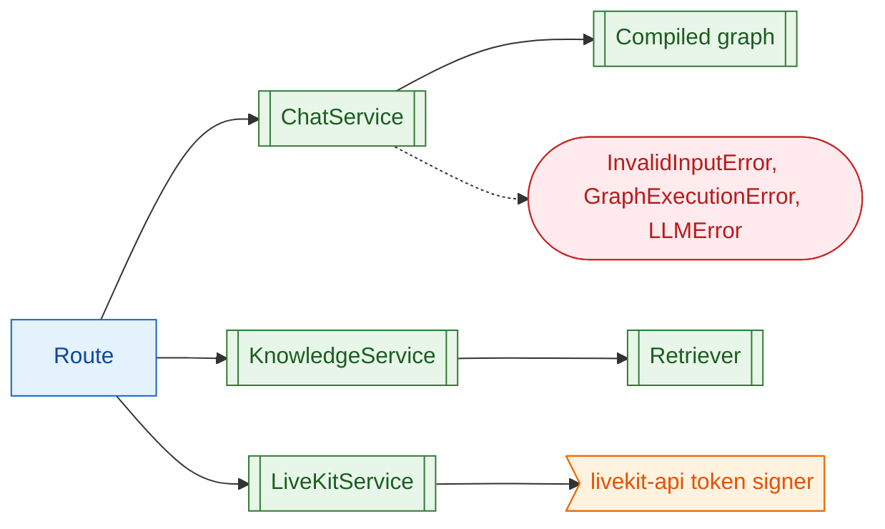

# 04 Services

**What this block is:** `src/services/`: the use cases of the API, written without any web framework. **Assumes:** [03](03-api-layer.md) (who calls services). **Next layer down:** [06 Agent graph](06-agent-graph.md), [08 Knowledge base](08-knowledge-base-rag.md).

## 1. The problem

If business rules live in route functions they can only be tested through HTTP, and they get copied when a second entry point appears (the voice worker needed the same agent). A service is a plain class: validate, call the layer below, return plain data, raise domain errors. No `Request`, no `HTTPException`, no FastAPI import. The layering rule (imports point downward only) forbids it, and reviewers hold to that.



## 2. ChatService: one user turn

Responsibilities, in order:

1. **Validate** the message: strip it, reject empty text, reject text over `MAX_INPUT_CHARS`.
2. **Build a run config** (`thread_id` = the session id, the step limit, tags, metadata, tracing callbacks) with `build_run_config` from [block 06](06-agent-graph.md).
3. **Bound concurrency** with a semaphore sized `MAX_CONCURRENT_RUNS`, so a burst of requests cannot start unlimited model calls.
4. **Run** the graph and translate failures into domain errors.

```python
# src/services/chat_service.py (ChatService.invoke)
async def invoke(self, session_id: str, message: str, request_id: str) -> ChatResult:
    """Run the graph to completion and return the final answer."""
    text = self._validate(message)
    config = self._config(session_id, request_id)
    async with self._semaphore:
        try:
            result = await self._graph.ainvoke({"messages": [HumanMessage(text)]}, config)
        except OmniVoxError:
            raise
        except GraphRecursionError as exc:
            raise GraphExecutionError("The agent hit its step limit") from exc
        except Exception as exc:
            raise GraphExecutionError(f"{type(exc).__name__}: {exc}") from exc
    messages = result["messages"]
    answer = last_answer(messages)
    if not answer:
        raise GraphExecutionError("The graph finished without an answer")
    return ChatResult(session_id, answer, self._tools_used(messages))
```

Notes on the details:

- The graph is called with **only the new human message**. The checkpointer (memory) already holds earlier turns for that `thread_id`; the `add_messages` reducer appends. Sending the history again would duplicate it.
- `GraphRecursionError` (the step limit) becomes `GraphExecutionError`; `OmniVoxError` (for example `LLMError` raised inside a node) passes through untouched so it keeps its specific status code; anything else is wrapped, which hides raw exception text from clients.
- `tools_used` is computed from messages **after the latest human message only**, otherwise a tool used three turns ago would be reported again:

```python
# src/services/chat_service.py (ChatService._tools_used)
def _tools_used(messages: list) -> list[str]:
    """Tool names called during the latest turn, in order, without repeats."""
    start = max((i for i, m in enumerate(messages) if isinstance(m, HumanMessage)), default=0)
    names: list[str] = []
    for message in messages[start:]:
        if isinstance(message, AIMessage):
            names.extend(
                call["name"] for call in message.tool_calls if call["name"] not in names
            )
    return names
```

`stream()` is the same flow but yields `SSEEvent` objects from `stream_graph` ([block 06](06-agent-graph.md)); it validates **before** the generator starts so a bad message becomes a normal 400/422 rather than an error frame.

## 3. KnowledgeService: documents in, passages out

It guards the door of the knowledge base ([block 08](08-knowledge-base-rag.md) has the machinery):

- **Size limit** `RAG_MAX_UPLOAD_BYTES` before any parsing.
- **Source name** sanitizing: the name is what users see and what the delete route takes, so path parts and control characters are stripped and the length is capped.
- **Text extraction in a thread** (`asyncio.to_thread`) because PDF parsing is CPU-bound and would block the event loop for every other request.

```python
# src/services/knowledge_service.py (KnowledgeService._source_name)
def _source_name(raw: str) -> str:
    name = CONTROL_CHARS.sub("", PurePath(raw.replace("\\", "/")).name).strip()
    if not name:
        raise InvalidInputError("The document needs a name.")
    return name[:SOURCE_MAX_CHARS]
```

```python
# src/services/knowledge_service.py (KnowledgeService.ingest)
async def ingest(self, filename: str, data: bytes, source: str | None = None) -> IngestResult:
    """Extract text from an uploaded file and (re)index it under ``source``."""
    if len(data) > self._settings.RAG_MAX_UPLOAD_BYTES:
        raise InvalidInputError(
            f"The file is larger than {self._settings.RAG_MAX_UPLOAD_BYTES} bytes."
        )
    name = self._source_name(source or filename)
    text = await asyncio.to_thread(extract_text, filename, data)
    return await self._retriever.ingest(name, text)
```

`delete` raises `NotFoundError` when nothing was deleted, which the API turns into a 404; the retriever itself just returns a count.

## 4. LiveKitService: join tokens

A LiveKit server only lets in clients holding a **signed token** (a JWT). The service signs one with the API key and secret, naming the identity and the one room it may join. A **new room name** is what makes LiveKit dispatch the voice agent ([block 09](09-livekit.md)), so by default each call gets a fresh `omnivox-<8 hex>` room.

```python
# src/services/livekit_service.py (LiveKitService.create_token)
def create_token(self, identity: str | None = None, room: str | None = None) -> JoinToken:
    """Sign a token for ``identity`` to join ``room`` (both generated when omitted)."""
    settings = self._settings
    identity = identity or f"{IDENTITY_PREFIX}{uuid.uuid4().hex[:ID_LENGTH]}"
    room = room or f"{ROOM_PREFIX}{uuid.uuid4().hex[:ID_LENGTH]}"
    token = (
        api.AccessToken(
            settings.LIVEKIT_API_KEY, settings.LIVEKIT_API_SECRET.get_secret_value()
        )
        .with_identity(identity)
        .with_name(identity)
        .with_grants(
            api.VideoGrants(
                room_join=True,
                room=room,
                can_publish=True,
                can_subscribe=True,
                can_publish_data=True,
            )
        )
        .with_ttl(timedelta(seconds=settings.LIVEKIT_TOKEN_TTL_SECONDS))
        .to_jwt()
    )
    return JoinToken(token=token, url=settings.LIVEKIT_PUBLIC_URL, room=room, identity=identity)
```

The grants say what the browser may do in that room only: join, publish audio, subscribe to the agent's audio, and send/receive data packets. It cannot administer the room or join another. The token expires after `LIVEKIT_TOKEN_TTL_SECONDS`.

## 5. Why services are plain classes (design notes)

- **Testability.** `tests/services/` runs the same code with a scripted model and an in-memory Qdrant, no HTTP involved.
- **Reuse.** The voice worker does not use `ChatService` (LiveKit owns the conversation) but it uses the same graph builder, tools and models; keeping HTTP out of services made that possible.
- **Errors as vocabulary.** A service says *what* went wrong (`InvalidInputError`), the API decides *how* to tell the client (400).

## Try it

```bash
uv run pytest tests/services -q
```

Then open `tests/services/test_chat_service.py` and read `test_tools_used_only_lists_the_latest_turn`: it runs two turns on one session and shows why `_tools_used` slices from the last human message.

## Modify it

Add a rule, for example "reject messages that are only punctuation": put it in `ChatService._validate`, raise `InvalidInputError("...")`, add a test with `pytest.raises`. No route changes: the existing handler already returns 400 with your message.

## Check yourself

- Why does `invoke` send only the new message to a graph that remembers the conversation?
- Which line makes a slow PDF upload not freeze the API for other users?
- What does the browser need from `LiveKitService` besides the token, and why is the room name generated per call?

## Read next

[05 Model layer](05-model-layer.md) for what the graph calls, or [06 Agent graph](06-agent-graph.md) for what the service calls.
