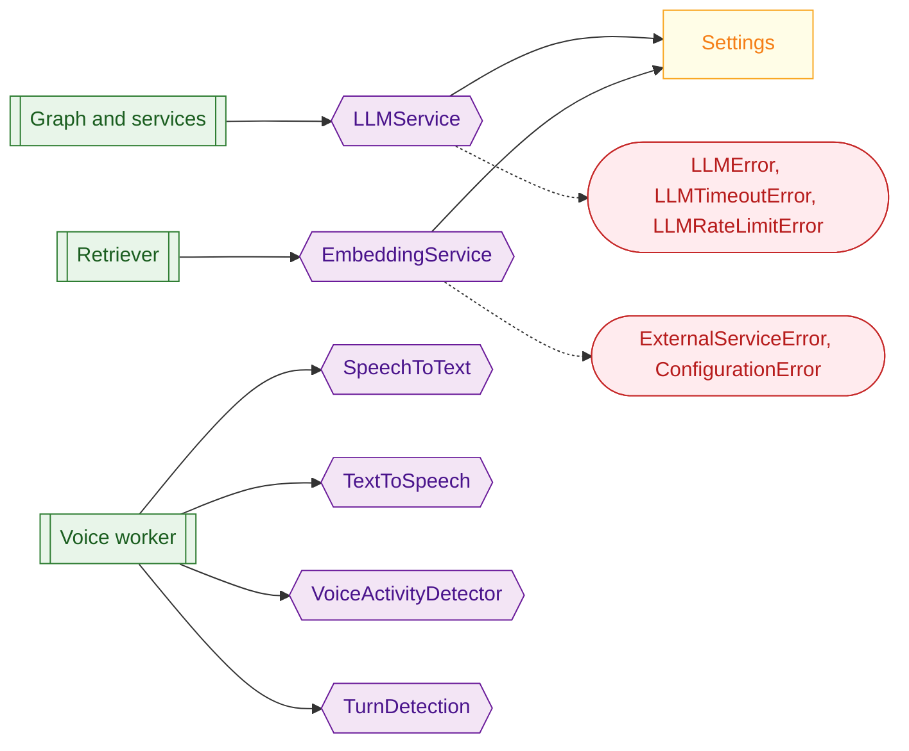

# 05 Model layer

**What this block is:** `src/ai_models/`: the only code that creates or calls an AI model client (LLM, embeddings, speech-to-text, text-to-speech, voice activity detection, turn detection) plus LangSmith tracing. **Assumes:** [02](02-configuration-and-logging.md). **Reference:** [llm.md](../llm.md).

## 1. The problem

Every model has its own SDK, its own error types, its own quirks and its own way of timing out. If the graph, the services and the worker each talked to them directly, a provider change would touch twenty files and every test would need the network. The rule here is simple: **nothing outside this folder builds a model client**. Everything else asks a wrapper and gets domain errors back.



## 2. The common base

Every wrapper extends `AIModel`: it must describe itself (`info`: kind, provider, model name, harmless details; never a secret) and it gets `traced()`, a context manager that logs how long a call took and, for the LLM, token counts. The API's `/info` endpoint and the Inspector's first event are built from these descriptions.

```python
# src/ai_models/base.py (AIModel.traced)
async def traced(self, operation: str, **metadata: Any) -> AsyncIterator[dict[str, Any]]:
    """Time a model call and log latency; callers add usage figures to the yielded dict."""
    outputs: dict[str, Any] = {}
    started = time.perf_counter()
    try:
        yield outputs
    finally:
        latency_ms = (time.perf_counter() - started) * 1000
        logger.info(
            "%s.%s model=%s latency_ms=%.0f %s",
            self.kind,
            operation,
            self.info.model,
            latency_ms,
            " ".join(f"{key}={value}" for key, value in {**metadata, **outputs}.items()),
        )
```

Provider exceptions are sorted into three kinds so the rest of the code never imports `openai` or `httpx`:

```python
# src/ai_models/base.py
def classify_provider_error(exc: BaseException) -> ErrorKind:
    """Sort a provider exception into the kinds the service layer cares about."""
    if isinstance(exc, (openai.APITimeoutError, httpx.TimeoutException, asyncio.TimeoutError)):
        return "timeout"
    if isinstance(exc, TimeoutError):
        return "timeout"
    if isinstance(exc, openai.RateLimitError):
        return "rate_limit"
    return "other"
```

## 3. LLMService

It wraps LangChain's `ChatOpenAI`, which speaks the OpenAI chat protocol, so **any compatible endpoint works** (Gemini, OpenRouter, vLLM, OpenAI) by changing `OPENAI_BASE_URL`, `OPENAI_MODEL` and the key.

```python
# src/ai_models/llm.py
def build_chat_model(settings: Settings) -> ChatOpenAI:
    """Create the chat client from settings. Retries and timeout live in the client itself.

    Each client gets its own HTTP client: LangChain would otherwise share a cached one whose
    connections belong to the first event loop, which breaks when another loop (a later voice
    session) uses it.
    """
    client_class = (
        GeminiChatOpenAI if GEMINI_HOST_MARKER in settings.OPENAI_BASE_URL else ChatOpenAI
    )
    return client_class(
        model=settings.OPENAI_MODEL,
        api_key=settings.OPENAI_API_KEY,
        base_url=settings.OPENAI_BASE_URL,
        temperature=settings.OPENAI_TEMPERATURE,
        max_tokens=settings.OPENAI_MAX_TOKENS,
        reasoning_effort=settings.OPENAI_REASONING_EFFORT,
        extra_body=thinking_extra_body(settings),
        timeout=settings.REQUEST_TIMEOUT,
        max_retries=settings.MAX_RETRIES,
        streaming=True,
        stream_usage=True,
        http_async_client=DefaultAsyncHttpxClient(timeout=settings.REQUEST_TIMEOUT),
    )
```

Points worth studying in that function:

- **Retries and timeout live in the client** (`max_retries`, `timeout`). There is deliberately no second retry layer: two layers multiply (3 x 3 = 9 attempts).
- **`streaming=True` and `stream_usage=True`** make tokens arrive as they are generated and ask the provider for token counts.
- **A private HTTP client per instance.** `langchain-openai` otherwise shares one cached HTTP client per base URL. The voice worker runs every call on its own event loop; the second call reused connections owned by the first loop and failed with "Event loop is closed". Each `LLMService` owns its client and closes it in `aclose()`.
- **`extra_body` carries the thinking switch** (next section).

`ainvoke` is the one method graph nodes use. It enforces the input limit, binds tools, converts failures, and checks the answer:

```python
# src/ai_models/llm.py (LLMService.ainvoke)
async def ainvoke(
    self,
    messages: Sequence[BaseMessage],
    *,
    tools: Sequence[Any] | None = None,
    config: RunnableConfig | None = None,
) -> AIMessage:
    """Run the model once and return a validated assistant message."""
    self._check_input(messages)
    runnable = self._model.bind_tools(list(tools)) if tools else self._model
    async with self.traced("ainvoke", messages=len(messages)) as outputs:
        try:
            result = await runnable.ainvoke(list(messages), config=config)
        except OmniVoxError:
            raise
        except Exception as exc:
            raise self._map_error(exc) from exc
        if not isinstance(result, AIMessage):
            raise LLMError(f"Unexpected model result type {type(result).__name__}")
        self._check_output(result)
        usage = result.usage_metadata or {}
        outputs["input_tokens"] = usage.get("input_tokens")
        outputs["output_tokens"] = usage.get("output_tokens")
        return result
```

```python
# src/ai_models/llm.py (LLMService._check_output)
def _check_output(result: AIMessage) -> None:
    finish = (result.response_metadata or {}).get("finish_reason")
    has_text = bool(message_text(result).strip())
    if not has_text and not result.tool_calls:
        if finish == FINISH_FILTERED:
            raise LLMError("The provider blocked the response (content filter)")
        raise LLMError(f"The model returned empty output (finish_reason={finish})")
    if finish == FINISH_TRUNCATED:
        logger.warning("Model output was truncated by the token limit")
```

An answer that is empty, or blocked by the provider's content filter, is an `LLMError`, because an empty reply is worse than an error: the caller would hear silence. A reply cut off by the token limit but not empty is returned with a warning.

### Thinking on or off

Open-source chat templates (Qwen, Gemma) read an `enable_thinking` flag, and OpenRouter has its own `reasoning` switch. One setting controls both, sent like `extra_body={"chat_template_kwargs": {"enable_thinking": False}, "reasoning": {"enabled": False}}` (the second key only on `openrouter.ai`):

```python
# src/ai_models/llm.py
def thinking_extra_body(settings: Settings) -> dict[str, Any] | None:
    """``extra_body`` that switches thinking on or off.

    Qwen, Gemma and similar models served by vLLM read ``enable_thinking`` from
    ``chat_template_kwargs``. OpenRouter does not forward that field for every model; it has its
    own ``reasoning`` parameter, which is added when the endpoint is OpenRouter. ``None`` (setting
    left blank) sends nothing and the model default applies.
    """
    thinking = settings.OPENAI_ENABLE_THINKING
    if thinking is None:
        return None
    body: dict[str, Any] = {"chat_template_kwargs": {"enable_thinking": thinking}}
    if OPENROUTER_HOST_MARKER in settings.OPENAI_BASE_URL:
        body["reasoning"] = {"enabled": thinking}
    return body
```

Blank sends nothing (model default), `false` is faster, `true` allows long reasoning. For Gemini use `OPENAI_REASONING_EFFORT` instead; for other hosts leave that blank.

Why the second key exists: with `nvidia/nemotron-3.5-lightning:free` on OpenRouter, `chat_template_kwargs.enable_thinking` changed nothing (about 220 output tokens for "17 times 24"), while `reasoning.enabled=false` cut it to 14 tokens and 0.6 s. Thinking is also what makes this model call tools reliably: with it off, a knowledge question in a voice call reached `knowledge_search` about half the time. The measurements are in [llm.md](../llm.md); speed and tool reliability are a trade-off you choose with this setting.

### Gemini 3 tool calls need their signature back

Gemini 3 returns a `thought_signature` with every tool call and answers HTTP 400 if the next request replays that tool call without it. `langchain-openai` throws the field away. `GeminiChatOpenAI` (chosen automatically for `generativelanguage.googleapis.com` URLs) remembers each signature as it streams and puts it back:

```python
# src/ai_models/llm.py (GeminiChatOpenAI._get_request_payload)
def _get_request_payload(self, input_: Any, *, stop: list[str] | None = None, **kwargs: Any):
    payload = super()._get_request_payload(input_, stop=stop, **kwargs)
    for message in payload.get("messages", []):
        for call in message.get("tool_calls") or []:
            signature = self._signatures.get(call.get("id", ""), SIGNATURE_BYPASS)
            call.setdefault("extra_content", {"google": {"thought_signature": signature}})
    return payload
```

If the id is unknown (after a restart, for example) it sends Google's documented `skip_thought_signature_validator` value. This bug was found by a live tool round trip, not by reading docs; the test is `tests/ai_models/test_llm.py`.

## 4. EmbeddingService

Turns text into vectors for the knowledge base ([block 08](08-knowledge-base-rag.md)). It batches (Cohere accepts at most 96 texts per request), limits concurrent requests with a semaphore, keeps result order, and finds the **vector size by probing** once, because Cohere's compatibility endpoint rejects a `dimensions` parameter and the size must not be hard-coded.

```python
# src/ai_models/embeddings.py (EmbeddingService.aembed_documents)
async def aembed_documents(self, texts: list[str]) -> list[list[float]]:
    """Embed texts in batches, preserving order."""
    if not texts:
        return []
    size = self._settings.EMBEDDING_BATCH_SIZE
    batches = [texts[start : start + size] for start in range(0, len(texts), size)]
    async with self.traced("aembed_documents", texts=len(texts), batches=len(batches)):
        results = await asyncio.gather(*(self._embed_batch(batch) for batch in batches))
    return [vector for batch in results for vector in batch]
```

```python
# src/ai_models/embeddings.py (EmbeddingService.dimension)
async def dimension(self) -> int:
    """Vector size of the model, found once by embedding a probe text."""
    if self._dimension is None:
        self._dimension = len(await self.aembed_query(PROBE_TEXT))
    return self._dimension
```

A missing `EMBEDDING_API_KEY` raises `ConfigurationError` only when embeddings are actually used, so the API starts without it.

## 5. Speech and turn-taking wrappers

These do not call models themselves. They **build the LiveKit plugin object** that `AgentSession` will drive ([block 10](10-voice-worker.md)), choosing by provider:

```python
# src/ai_models/asr.py (SpeechToText.build)
def build(self) -> stt.STT:
    """Create the STT plugin; raises ``ConfigurationError`` when its settings are incomplete."""
    settings = self._settings
    if settings.STT_PROVIDER == "elevenlabs":
        if settings.ELEVENLABS_API_KEY is None:
            raise ConfigurationError(
                "ELEVENLABS_API_KEY is required for STT_PROVIDER=elevenlabs."
            )
        return elevenlabs.STT(
            model=settings.STT_MODEL,
            api_key=settings.ELEVENLABS_API_KEY.get_secret_value(),
            language_code=settings.STT_LANGUAGE or NOT_GIVEN,
        )
    if not settings.STT_BASE_URL:
        raise ConfigurationError("STT_BASE_URL is required for STT_PROVIDER=openai.")
    key = (
        settings.STT_API_KEY.get_secret_value() if settings.STT_API_KEY else PLACEHOLDER_API_KEY
    )
    return openai.STT(
        model=settings.STT_MODEL,
        base_url=settings.STT_BASE_URL,
        api_key=key,
        language=settings.STT_LANGUAGE or "en",
        detect_language=not settings.STT_LANGUAGE,
    )
```

- `elevenlabs`: the native streaming plugins (`scribe_v2_realtime`, `eleven_v4_turbo`).
- `openai`: any server speaking the OpenAI audio API (vLLM, for example) through `STT_BASE_URL` / `TTS_BASE_URL`. A blank key becomes the placeholder `EMPTY` because the OpenAI client refuses an empty string while self-hosted servers ignore it. This switch is how the whole voice pipeline was tested offline against a fake server.

`VoiceActivityDetector.load()` loads the Silero ONNX model (blocking, so the worker calls it once in `prewarm`). `TurnDetection.options()` turns settings into LiveKit's turn handling options:

```python
# src/ai_models/turn.py (TurnDetection.options)
def options(self) -> TurnHandlingOptions:
    """Turn handling options for ``AgentSession``."""
    settings = self._settings
    detection = (
        inference.TurnDetector(version=LOCAL_TURN_MODEL_VERSION)
        if settings.TURN_DETECTOR == "audio"
        else settings.TURN_DETECTOR
    )
    return TurnHandlingOptions(
        turn_detection=detection,
        endpointing={
            "mode": "fixed",
            "min_delay": settings.MIN_ENDPOINTING_DELAY,
            "max_delay": settings.MAX_ENDPOINTING_DELAY,
        },
        interruption={"enabled": settings.ALLOW_INTERRUPTIONS, "mode": "vad"},
        preemptive_generation={"enabled": settings.PREEMPTIVE_GENERATION},
    )
```

`inference.TurnDetector(version="v1-mini")` is LiveKit's **local** audio end-of-turn model: no account, no network. The full `v1` model needs LiveKit Inference credentials, and "adaptive" interruption detection does too, which is why interruptions use plain VAD here.

## 6. Tracing

`Tracing` returns LangSmith callbacks for a run and records extra runs, and does nothing when `TRACING_PROVIDER=none`. Tracing must never break a request, so every failure is logged and swallowed:

```python
# src/ai_models/tracing.py (Tracing.get_callbacks)
def get_callbacks(self, metadata: dict[str, Any] | None = None) -> list[BaseCallbackHandler]:
    """Callbacks to put in a ``RunnableConfig``; empty when tracing is off."""
    if self._client is None:
        return []
    try:
        from langchain_core.tracers.langchain import LangChainTracer

        return [LangChainTracer(project_name=self._project, client=self._client)]
    except Exception as exc:
        logger.warning("LangSmith tracer could not be created: %s", type(exc).__name__)
        return []
```

## 7. Mistakes that happened here

| What happened | Cause | Fix |
| --- | --- | --- |
| 400 on the second step of every tool loop with Gemini 3 | thought signature dropped | `GeminiChatOpenAI` |
| "Event loop is closed" on the second voice call | shared cached HTTP client | one client per service |
| ElevenLabs 402 on first TTS | default voice was a library voice, unavailable on free plans | default voice Sarah |
| 429 with a Google key | free tier is about 20 requests per day | paid key or another provider |
| Unrelated tests hit the network | a client was built at import time | clients are built in `build_runtime`, never at import |

## Try it

```bash
uv run pytest tests/ai_models -q
```

These tests build every model wrapper with injected fakes and raise provider errors on purpose. Open `tests/ai_models/test_llm.py` to see how each provider error is converted into a domain error.

## Modify it

To support a new LLM host nothing changes in code: set the three variables. To support a quirk (like Gemini's signatures) subclass `ChatOpenAI` in `llm.py` and select it in `build_chat_model`. A new model **type** gets its own module with an `AIModel` subclass and an `info`.

## Check yourself

- Why is there no retry loop in `LLMService`?
- What would you see if two `LLMService` objects shared one HTTP client inside the voice worker?
- Why does `EmbeddingService.dimension()` embed a probe text instead of reading a setting?

## Read next

[06 Agent graph](06-agent-graph.md), the main user of `LLMService`; or [10 Voice worker](10-voice-worker.md) for the speech wrappers.
