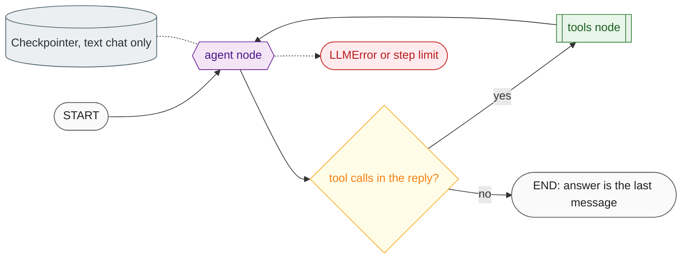

# 06 Agent graph

**What this block is:** `src/graph/`: the agent as a LangGraph state machine, with its nodes, router, memory, run configuration and streaming. **Assumes:** [05](05-model-layer.md) (the LLM it calls). **Reference:** [graph.md](../graph.md).

## 1. LangGraph in five minutes

If you know LangGraph, skip to section 2. Otherwise these are the only ideas you need:

| Idea | Meaning |
| --- | --- |
| **State** | A typed dict that flows through the graph. Ours has one field, `messages`. |
| **Reducer** | A rule for merging a node's update into the state. `add_messages` *appends* (and replaces a message that has the same id) instead of overwriting. |
| **Node** | An async function: state in, partial update out (`{"messages": [reply]}`). |
| **Edge** | "After node A run node B." A **conditional edge** calls a small router function that returns the next node's name. |
| **Superstep** | The graph runs in steps. In each step the triggered nodes run, then their updates are merged. `recursion_limit` caps the number of steps and stops runaway loops. |
| **Checkpointer** | Optional storage that saves the state after each step under a `thread_id`, so the next call on that thread continues the conversation. |
| **Stream modes** | `values` (full state after each step), `updates` (each node's output), `messages` (LLM tokens as they are produced). |

## 2. Our graph



This is the classic "ReAct" loop, written by hand so every step is visible: the model either answers or asks for tools; tool results are appended; the model looks again.

### State

```python
# src/graph/state.py
class AgentState(TypedDict):
    """Conversation messages; ``add_messages`` appends instead of replacing."""

    messages: Annotated[list[AnyMessage], add_messages]
```

### The router

```python
# src/graph/builder.py
def route_after_agent(state: AgentState) -> Literal["tools", "__end__"]:
    """Run tools when the model asked for them, otherwise finish."""
    last = state["messages"][-1]
    return NODE_TOOLS if isinstance(last, AIMessage) and last.tool_calls else END
```

It reads only the last message: an `AIMessage` with `tool_calls` means "run tools", anything else ends the run.

### The wiring

```python
# src/graph/builder.py
def build_graph(
    *,
    llm: LLMService,
    tools: Sequence[BaseTool],
    settings: Settings,
    checkpointer: BaseCheckpointSaver | None = None,
) -> CompiledStateGraph:
    """Compile the graph. Pass a checkpointer for thread memory, none for a stateless graph."""
    graph = StateGraph(AgentState)
    graph.add_node(NODE_AGENT, make_agent_node(llm, tools, settings))
    graph.add_node(NODE_TOOLS, make_tools_node(tools))
    graph.add_edge(START, NODE_AGENT)
    graph.add_conditional_edges(NODE_AGENT, route_after_agent, [NODE_TOOLS, END])
    graph.add_edge(NODE_TOOLS, NODE_AGENT)
    return graph.compile(checkpointer=checkpointer, name=GRAPH_NAME)
```

Notice `checkpointer` is a parameter: the **same function** builds the text-chat graph (with memory) and the voice graph (without), see section 5.

### The agent node

```python
# src/graph/nodes/agent.py (make_agent_node.agent)
async def agent(state: AgentState, config: RunnableConfig) -> dict[str, list[AIMessage]]:
    started = time.perf_counter()
    history = [m for m in state["messages"] if not isinstance(m, SystemMessage)]
    window = trim_messages(
        history,
        max_tokens=settings.GRAPH_MAX_HISTORY_MESSAGES,
        token_counter=len,
        strategy="last",
        start_on="human",
    )
    prompt = await AGENT_PROMPT.ainvoke(
        {
            "messages": window,
            "current_datetime": datetime.now(timezone.utc).strftime(TIME_FORMAT),
        }
    )
    logger.info("%s: start (history=%d messages)", NODE_AGENT, len(window))
    reply = await llm.ainvoke(prompt.to_messages(), tools=tools, config=config)
    logger.info(
        "%s: done in %.0f ms (tool_calls=%d)",
        NODE_AGENT,
        (time.perf_counter() - started) * 1000,
        len(reply.tool_calls),
    )
    return {"messages": [reply]}
```

Step by step:

1. **Drop incoming system messages.** The prompt module owns the instructions; LiveKit may send its own empty one.
2. **Trim history** to the last `GRAPH_MAX_HISTORY_MESSAGES` messages, always starting on a human message (a window that began on a tool result would be invalid for the model).
3. **Apply the system prompt** with the current time ([block 07](07-tools-and-prompts.md)).
4. **Call the model with the tools bound.** Because the graph is run in a streaming mode by its callers, the model's tokens stream out while this call is still in progress.

### The tools node

```python
# src/graph/nodes/tools.py
async def _run_call(
    registry: dict[str, BaseTool], call: dict[str, Any], config: RunnableConfig
) -> ToolMessage:
    name, call_id = call["name"], call["id"]
    tool = registry.get(name)
    if tool is None:
        logger.warning("Model requested unknown tool %s", name)
        return ToolMessage(UNKNOWN_TOOL_RESULT, tool_call_id=call_id, name=name, status="error")
    try:
        output = await tool.ainvoke(call["args"], config)
    except Exception as exc:
        logger.warning("Tool %s failed: %s: %s", name, type(exc).__name__, exc)
        return ToolMessage(TOOL_ERROR_RESULT, tool_call_id=call_id, name=name, status="error")
    return ToolMessage(str(output), tool_call_id=call_id, name=name)
```

It runs **every tool call of the last assistant message in parallel** (`asyncio.gather`). A call to a tool that does not exist, or a tool that raises, becomes a `ToolMessage` with `status="error"` and a safe text. The model sees "that failed" and can apologize, instead of the whole run crashing. The error text never contains the exception message, so a provider payload cannot leak to the user through the model.

## 3. Run configuration

Every run gets a `RunnableConfig` that carries the conversation id, the step limit, tags and metadata for tracing, and the callbacks:

```python
# src/graph/trace.py
def build_run_config(
    settings: Settings,
    tracing: Tracing,
    *,
    session_id: str,
    request_id: str,
    handlers: Sequence[BaseCallbackHandler] = (),
    tags: Sequence[str] = (),
    metadata: dict[str, Any] | None = None,
) -> RunnableConfig:
    """Config for one graph run: thread, step limit, tags, metadata and tracing callbacks."""
    run_metadata = {
        "service": settings.APP_NAME,
        "session_id": session_id,
        "request_id": request_id,
        **(metadata or {}),
    }
    return RunnableConfig(
        run_name=RUN_NAME,
        configurable={"thread_id": session_id},
        recursion_limit=settings.GRAPH_RECURSION_LIMIT,
        tags=[settings.APP_NAME, *tags],
        metadata=run_metadata,
        callbacks=[*tracing.get_callbacks(run_metadata), *handlers],
    )
```

`thread_id` is what the checkpointer uses to find the right conversation. `recursion_limit` is `GRAPH_RECURSION_LIMIT`: one tool round trip is three steps (agent, tools, agent) and each extra round adds two, so the default 25 allows roughly ten tool rounds before `GraphRecursionError`, which the service turns into `graph_error`.

## 4. Memory

```python
# src/graph/memory.py
async def open_checkpointer(settings: Settings) -> AsyncIterator[BaseCheckpointSaver]:
    """Open the configured checkpointer and close it when the context exits."""
    if settings.GRAPH_MEMORY_BACKEND == "sqlite":
        path = Path(settings.GRAPH_MEMORY_URL)
        path.parent.mkdir(parents=True, exist_ok=True)
        async with AsyncSqliteSaver.from_conn_string(str(path)) as saver:
            logger.info("Graph memory: sqlite")
            yield saver
    else:
        logger.info("Graph memory: in-process")
        yield InMemorySaver()
```

`memory` keeps conversations in the process (lost on restart); `sqlite` keeps them in a file. It is opened in the API's lifespan and closed on shutdown.

## 5. The voice graph has no memory on purpose

LiveKit's chat context already holds the conversation and sends the **whole history** on every call. If the graph also had a checkpointer, each turn would be appended on top of a thread that already contains it, and the model would see everything twice. So `Runtime.build_graph()` is called without a checkpointer in the worker, and with one in the API. The cost: tool calls and results of earlier turns are not remembered in voice (only the spoken text is); that is acceptable because the answers already summarize them.

## 6. Streaming to the browser

`stream_graph` runs the graph in a task and merges two sources into one queue: the graph's own `messages` stream (the tokens) and trace events from `TraceCallbackHandler` ([block 11](11-inspector.md)), which it converts into `node` and `tool` frames:

```python
# src/graph/streaming.py
async def stream_graph(
    graph: CompiledStateGraph,
    text: str,
    config: RunnableConfig,
    *,
    session_id: str,
    request_id: str,
    max_chars: int,
) -> AsyncIterator[SSEEvent]:
    """Run one user turn and yield SSE events, always ending with ``final`` or ``error``."""
    queue: asyncio.Queue[Any] = asyncio.Queue()

    def on_trace(event: TraceEvent) -> None:
        if (frame := _from_trace(event)) is not None:
            queue.put_nowait(frame)

    handler = TraceCallbackHandler(on_trace, max_chars=max_chars)
    run_config: RunnableConfig = {
        **config,
        "callbacks": [*(config.get("callbacks") or []), handler],
    }

    async def run() -> None:
        state: dict[str, Any] = {}
        try:
            async for mode, payload in graph.astream(
                {"messages": [HumanMessage(text)]}, run_config, stream_mode=["messages", "values"]
            ):
                if mode == "values":
                    state = payload
                    continue
                chunk, meta = payload
                is_agent_text = isinstance(chunk, AIMessageChunk) and (
                    meta.get("langgraph_node") == NODE_AGENT
                )
                if is_agent_text and (token := message_text(chunk)):
                    queue.put_nowait(SSEEvent("token", {"text": token}))
            answer = last_answer(state.get("messages", []))
            if not answer:
                raise GraphExecutionError("The graph finished without an answer")
            queue.put_nowait(SSEEvent("final", {"answer": answer, "session_id": session_id}))
        except Exception as exc:
            queue.put_nowait(error_event(exc, request_id))
        finally:
            queue.put_nowait(_DONE)

    task = asyncio.create_task(run())
    try:
        while (item := await queue.get()) is not _DONE:
            yield item
    finally:
        task.cancel()
```

Rules this function keeps (each has a test in `tests/graph/test_streaming.py`):

- the stream **always ends with exactly one `final` or `error`**; every exception is converted, never leaked;
- tokens come from the `agent` node only;
- if the consumer stops reading (browser closed), the `finally` cancels the graph task, so a closed tab does not keep paying for model calls.

## 7. Mistakes that happened here

| What happened | Cause | Fix |
| --- | --- | --- |
| A test loop never hit the step limit | the fake model returned the *same message object* each time, so `add_messages` replaced the previous reply instead of appending | fakes return a copy with `id=None` |
| Order of trace events surprised me | the router runs inside the agent node's run, so `route` comes before `node_end` | tests assert the real order |
| Tool results read aloud on a call | LiveKit's adapter speaks every streamed message including `ToolMessage` | `SpeakableGraph` ([block 10](10-voice-worker.md)) |

## Try it

```bash
uv run pytest tests/graph -q
```

Then read `tests/graph/test_builder.py::test_tool_loop_runs_tool_and_answers`: it scripts a model that asks for `web_search` and then answers, runs the real graph, and asserts the message sequence `Human, AI, Tool, AI`. Change the script to loop forever and watch `test_recursion_limit_stops_endless_tool_loops` explain the step limit.

## Modify it

- **Add a node** (for example "summarize history"): a module in `src/graph/nodes/`, `graph.add_node`, an edge or a router branch in `builder.py`, a constant in `state.py`, and a test with the scripted model.
- **Add a tool:** see [block 07](07-tools-and-prompts.md); the graph itself does not change.

## Check yourself

- Why does `route_after_agent` only look at the last message?
- A tool raises `RuntimeError("secret detail")`. What does the model see, and what does the user see?
- What would go wrong if the voice graph were compiled with a checkpointer?
- How many steps does a turn with two tool rounds use?

## Read next

[07 Tools and prompts](07-tools-and-prompts.md); then [11 Inspector](11-inspector.md) for the callback handler used in streaming.
