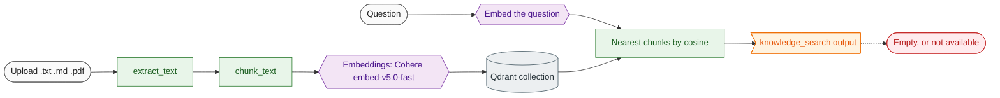

# 08 Knowledge base (RAG)

**What this block is:** the code that lets the agent answer from your own documents: loading files, splitting them, embedding, storing in Qdrant, and searching. Files: `src/rag/`, `src/clients/qdrant.py`, `src/ai_models/embeddings.py`. **Assumes:** [05](05-model-layer.md) for embeddings. **Used by:** [07](07-tools-and-prompts.md) (`knowledge_search`) and [04](04-services.md) (uploads).

## 1. The idea

A language model does not know your documents and cannot read a 200-page PDF on every question. **Retrieval-augmented generation** does the reading ahead of time:

1. **Ingest (once per document).** Cut the document into small chunks, turn each chunk into an **embedding** (a vector of numbers that captures its meaning) and store it.
2. **Retrieve (every question).** Embed the question the same way and find the stored chunks whose vectors are closest.
3. **Generate.** Give those chunks to the model as context, and let it answer from them.



## 2. Loading: `extract_text`

Plain text and Markdown are decoded as UTF-8 (bad bytes are replaced, not fatal). PDFs go through `pypdf`. Anything else is rejected with a message listing the supported types. Text is normalized (line endings, repeated spaces, blank lines) and an empty result is an error ("no extractable text"), which catches scanned PDFs that contain only images.

```python
# src/rag/loaders.py
def extract_text(filename: str, data: bytes) -> str:
    """Extract normalized text from a txt, md or pdf file. Blocking: call from a worker thread."""
    extension = PurePath(filename).suffix.lower()
    if extension in TEXT_EXTENSIONS:
        text = data.decode("utf-8", errors="replace")
    elif extension == PDF_EXTENSION:
        text = _pdf_text(data)
    else:
        raise InvalidInputError(
            f"Unsupported file type '{extension or 'none'}'. Use one of: "
            f"{', '.join(SUPPORTED_EXTENSIONS)}."
        )
    text = normalize_text(text)
    if not text:
        raise InvalidInputError("The file contains no extractable text.")
    return text
```

## 3. Chunking: `chunk_text`

Why chunk at all? An embedding of a whole book is a blur; an embedding of one paragraph is sharp, and the model's context window is limited. Why overlap? A sentence that straddles a boundary would otherwise be cut in half and become unfindable.

The algorithm, in plain words:

1. Normalize the text. If it is shorter than `RAG_CHUNK_SIZE`, it is one chunk.
2. Split on blank lines and sentence ends (`. ! ?` and the Arabic question mark) into **units**; a unit longer than the size is split at spaces.
3. Pack units greedily into a chunk until the next one would not fit.
4. Start the next chunk with the **last `RAG_CHUNK_OVERLAP` characters** of the previous one, snapped to a word boundary.

```python
# src/utils/text.py
def chunk_text(text: str, size: int, overlap: int) -> list[str]:
    """Split text into chunks of at most ``size`` characters.

    Chunks break on paragraph and sentence boundaries; each chunk starts with the last
    ``overlap`` characters of the previous one so context is not cut mid-thought.
    """
    if size <= 0 or overlap < 0 or overlap >= size:
        raise ValueError("size must be positive and overlap must be in [0, size)")
    text = normalize_text(text)
    if not text:
        return []
    if len(text) <= size:
        return [text]

    units: list[str] = []
    for part in SENTENCE_BREAK.split(text):
        part = part.strip()
        if part:
            units.extend(_split_long(part, size))

    chunks: list[str] = []
    current = ""
    for unit in units:
        candidate = f"{current} {unit}" if current else unit
        if len(candidate) <= size:
            current = candidate
            continue
        chunks.append(current)
        tail = _tail(current, overlap)
        current = f"{tail} {unit}" if tail else unit
        if len(current) > size:
            current = unit
    if current:
        chunks.append(current)
    return chunks
```

Defaults: 800 characters per chunk, 100 overlap. They are settings because the right values depend on your documents: short FAQ entries want small chunks, legal text wants larger ones.

## 4. Embeddings

Done by `EmbeddingService` ([block 05](05-model-layer.md)): batches of at most 96 texts, a bounded number of concurrent requests, order preserved. The vector size comes from probing the model (Cohere's `embed-v5.0-fast` returns 2048 dimensions), not from a constant.

Documents and queries must be embedded by **the same model family**. If you change `EMBEDDING_MODEL`, old vectors become meaningless: use a new `QDRANT_COLLECTION`.

## 5. Storage: `QdrantStore`

Qdrant keeps each chunk as a **point**: an id, the vector, and a payload (`source`, `chunk_index`, `text`).

```python
# src/clients/qdrant.py (QdrantStore.ensure_collection)
async def ensure_collection(self, dimension: int) -> None:
    """Create the collection (cosine distance, indexed ``source``) or check its vector size."""
    async with self._guard("ensure_collection"):
        if await self._client.collection_exists(self._collection):
            info = await self._client.get_collection(self._collection)
            vectors = info.config.params.vectors
            existing = vectors.size if isinstance(vectors, qm.VectorParams) else None
            if existing is not None and existing != dimension:
                raise ExternalServiceError(
                    f"Collection {self._collection} holds {existing}-dimension vectors but "
                    f"the embedding model produces {dimension}. Use another QDRANT_COLLECTION."
                )
            return
        await self._client.create_collection(
            self._collection,
            vectors_config=qm.VectorParams(size=dimension, distance=qm.Distance.COSINE),
        )
        await self._client.create_payload_index(
            self._collection, SOURCE_FIELD, qm.PayloadSchemaType.KEYWORD
        )
        logger.info("Created collection %s (dimension %d)", self._collection, dimension)
```

- The collection uses **cosine** distance and is created on first ingest with the probed size. If a collection exists with another size you get a clear error instead of a corrupt index.
- A **keyword index on `source`** makes per-document operations fast.
- Point ids are **deterministic** (UUID v5 of `source#index`), so uploading the same document twice overwrites chunks instead of duplicating them:

```python
# src/clients/qdrant.py
def point_id(source: str, chunk_index: int) -> str:
    """Stable id for a chunk, so re-ingesting a document overwrites instead of duplicating."""
    return str(uuid.uuid5(POINT_NAMESPACE, f"{source}#{chunk_index}"))
```

- Listing documents scrolls through payloads and counts by `source`; deleting uses a filter on `source` and returns how many points it removed.
- `QDRANT_URL=:memory:` runs an in-process Qdrant: that is how the whole test suite runs without a server.

## 6. Ingest and search: `Retriever`

```python
# src/rag/retriever.py (Retriever.ingest)
async def ingest(self, source: str, text: str) -> IngestResult:
    """Replace the stored chunks of ``source`` with freshly embedded ones."""
    chunks = chunk_text(text, self._settings.RAG_CHUNK_SIZE, self._settings.RAG_CHUNK_OVERLAP)
    if not chunks:
        raise InvalidInputError("The document contains no text to index.")
    vectors = await self._embeddings.aembed_documents(chunks)
    await self._store.ensure_collection(len(vectors[0]))
    await self._store.delete_document(source)
    await self._store.upsert(source, chunks, vectors)
    logger.info("Ingested document: %d chunk(s), %d characters", len(chunks), len(text))
    return IngestResult(source=source, chunks=len(chunks), characters=len(text))
```

The order is chosen on purpose: **embed first, then delete the old version, then write the new one.** If the embedding service fails, the old copy of the document is still there. (`tests/rag/test_retriever.py::test_failed_embedding_keeps_the_old_document` proves it.)

```python
# src/rag/retriever.py (Retriever.search)
async def search(self, query: str, *, top_k: int | None = None) -> list[Passage]:
    """Closest passages to ``query`` above the configured score threshold."""
    vector = await self._embeddings.aembed_query(query)
    passages = await self._store.search(
        vector,
        top_k=top_k or self._settings.RAG_TOP_K,
        score_threshold=self._settings.RAG_SCORE_THRESHOLD,
    )
    logger.info("Knowledge search returned %d passage(s)", len(passages))
    return passages
```

## 7. Reading the scores

Cosine similarity runs from 0 (unrelated) to 1 (identical text). With `embed-v5.0-fast`, measured on real documents:

| Query kind | Score |
| --- | --- |
| clearly answered by a chunk | about 0.27 to 0.47 |
| unrelated | about 0.13 to 0.19 |

So scores look low in absolute terms; what matters is the gap. `RAG_SCORE_THRESHOLD=0.2` removes unrelated chunks; the default `0` keeps everything and lets the model judge. A measured ranking on a five-topic handbook put the right chunk first for 3 of 4 questions and second for the fourth ("chat tools" versus a chunk about Slack and Teams): the default `RAG_TOP_K=4` still delivers it.

## 8. Mistakes that happened here

| What happened | Cause | Fix |
| --- | --- | --- |
| Hash-based test embeddings ranked the wrong document | 32 dimensions collide, and words like "the" dominate | test fake uses 256 dimensions and ignores stop words |
| A 1-chunk document made every question look relevant | a single chunk is always the nearest | threshold guidance above |
| Knowledge routes returned 503 | `EMBEDDING_API_KEY` was empty | by design: clear `service_not_configured` message |
| Upload "did nothing" in a shell test | the file path belonged to a different `/tmp` than the tool saw | use a path both can see |

## Try it

```bash
make run
curl -s -X POST http://localhost:8100/api/v1/knowledge/documents -F "file=@README.md"
curl -s -X POST http://localhost:8100/api/v1/knowledge/search -H "Content-Type: application/json" -d "{\"query\":\"How long is the free trial?\",\"top_k\":2}"
```

(Needs `EMBEDDING_API_KEY` and Qdrant at `QDRANT_URL`.) Compare the score of that query with the score of "how to bake bread". Then try the chunker alone:

```bash
uv run python -c "from src.utils.text import chunk_text; [print(i, repr(c[:50]), len(c)) for i, c in enumerate(chunk_text(open('README.md').read() * 3, 300, 60))]"
```

## Modify it

- Better chunks for your documents: change `RAG_CHUNK_SIZE` and `RAG_CHUNK_OVERLAP`, re-upload, compare search results.
- A new file type: add a branch in `extract_text`, a test in `tests/rag/test_loaders.py`, and mention it in `docs/api.md`.

## Check yourself

- Why must a query and the documents use the same embedding model?
- You upload `a.md` twice. Which design choice prevents duplicate chunks?
- What happens to the old version of a document if the embedding API is down during re-upload?
- What does `RAG_SCORE_THRESHOLD=0.2` change for a question the documents cannot answer?

## Read next

[09 LiveKit](09-livekit.md) to start the voice half of the system.
