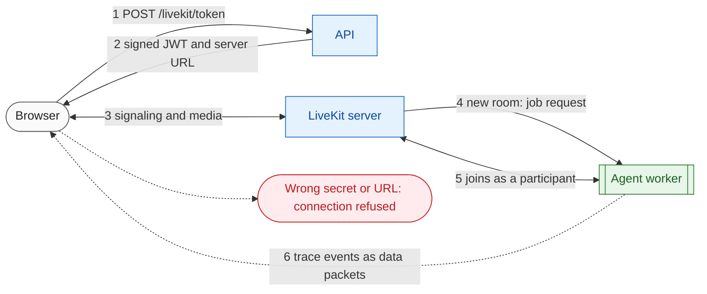

# 09 LiveKit

**What this block is:** a primer on LiveKit, the real-time media server that connects the browser to the voice agent, and an account of exactly how OmniVox uses it. **Assumes:** nothing (knowing "WebRTC is browser audio and video" helps). **Next:** [10 Voice worker](10-voice-worker.md) is the program that joins the rooms described here.

## 1. The problem LiveKit solves

A browser can capture a microphone and play sound, but getting audio **in real time, over the internet, through firewalls, with echo cancellation and packet loss handling** is hard. That is what WebRTC does, and LiveKit is an open-source server and SDK family built on it. We do not write any of that: we create a token, the browser joins, and the agent joins, and LiveKit moves the audio between them.

LiveKit is an **SFU** (selective forwarding unit): every participant sends its media to the server once, and the server forwards it to the others. For OmniVox that means two participants per room: the caller and the agent.



## 2. The vocabulary

| Term | Meaning | In OmniVox |
| --- | --- | --- |
| **Server** | The LiveKit process (Go). Listens on 7880 for signaling (HTTP and WebSocket), 7881 for TCP media, 7882 for UDP media. | a container from `deployment/docker-compose.yml` |
| **Room** | A named space. It exists while someone is in it. | one per call, named `omnivox-<8 hex>` |
| **Participant** | Anyone in a room, identified by an `identity`. A participant can be a browser, an agent, a phone. | the caller (`user-...`) and the agent (`agent-...`) |
| **Track** | One stream of audio or video that a participant **publishes**; others **subscribe**. | the caller's microphone track; the agent's voice track |
| **Data packet** | A small message sent through the room next to the media, with an optional `topic`, reliable or lossy, to everyone or chosen identities. Maximum about 15 KB. | the Inspector events, topic `omnivox.trace` |
| **Text stream** | A larger text message delivered in chunks. LiveKit agents use it to send transcriptions. | the agent's reply text, read by the browser with `useTranscriptions()` |
| **Participant attributes** | Key-value strings attached to a participant. | the agent publishes its state (`listening`, `thinking`, `speaking`) as `lk.agent.state` |
| **Access token** | A JWT signed with the API key and secret. States who you are and what you may do. | `LiveKitService.create_token` |
| **Agents framework** | A Python SDK for programs that join rooms as participants. | `livekit-agents` plus plugins |
| **Worker, job, dispatch** | A worker registers with the server and waits. When a room needs an agent, the server **dispatches** a **job** to a free worker. | `AgentServer` in `src/voice/worker.py` |

## 3. Tokens: how the browser is allowed in

The LiveKit server trusts nobody. A client joins only with a token signed by the same API key and secret the server was started with. Our token names one identity, one room, and a few abilities:

<!-- excerpt: src/services/livekit_service.py::LiveKitService.create_token -->
```python
# src/services/livekit_service.py (LiveKitService.create_token)
def create_token(self, identity: str | None = None, room: str | None = None) -> JoinToken:
    """Sign a token for ``identity`` to join ``room`` (both generated when omitted)."""
    settings = self._settings
    identity = identity or f"{IDENTITY_PREFIX}{uuid.uuid4().hex[:ID_LENGTH]}"
    room = room or f"{ROOM_PREFIX}{uuid.uuid4().hex[:ID_LENGTH]}"
    token = (
        api.AccessToken(
            settings.LIVEKIT_API_KEY, settings.LIVEKIT_API_SECRET.get_secret_value()
        )
        .with_identity(identity)
        .with_name(identity)
        .with_grants(
            api.VideoGrants(
                room_join=True,
                room=room,
                can_publish=True,
                can_subscribe=True,
                can_publish_data=True,
            )
        )
        .with_ttl(timedelta(seconds=settings.LIVEKIT_TOKEN_TTL_SECONDS))
        .to_jwt()
    )
    return JoinToken(token=token, url=settings.LIVEKIT_PUBLIC_URL, room=room, identity=identity)
```

- `room_join=True, room=room`: may join **that** room only.
- `can_publish`, `can_subscribe`: send its microphone, hear the agent.
- `can_publish_data`: allowed to send data packets (not used by the GUI today, kept for future features).
- It does **not** get `room_admin`, so it cannot kick people or close rooms.

The URL in the response is `LIVEKIT_PUBLIC_URL` (what the **browser** can reach). The server-side processes use `LIVEKIT_URL` (what the **API and worker** can reach). They are the same on one machine and different in Docker or production.

If the secret in `.env` differs from the secret the server runs with, the join fails with "token rejected": the GUI shows "LiveKit rejected the access token".

## 4. The server we run

Locally a container runs LiveKit with a small config passed through an environment variable:

<!-- excerpt: deployment/docker-compose.yml:L31-53 -->
```yaml
# deployment/docker-compose.yml
livekit:
  image: livekit/livekit-server:v1.13.11
  profiles: ["app", "gui", "infra"]
  restart: unless-stopped
  ports:
    - "7880:7880"
    - "7881:7881"
    - "7882:7882/udp"
  # Also the network of the agent (see below), so the agent can reach host.docker.internal.
  extra_hosts:
    - "host.docker.internal:host-gateway"
  environment:
    # LIVEKIT_NODE_IP is the address clients use to reach media. 127.0.0.1 suits a browser on
    # this machine; set the host LAN/public IP when browsers connect from another machine.
    LIVEKIT_CONFIG: |
      port: 7880
      rtc:
        tcp_port: 7881
        udp_port: 7882
        use_external_ip: false
        node_ip: ${LIVEKIT_NODE_IP:-127.0.0.1}
      keys:
        ${LIVEKIT_API_KEY}: ${LIVEKIT_API_SECRET}
```

The line that surprises people is `node_ip`. WebRTC peers exchange candidate addresses and pick one that works. The server must **tell the browser an address the browser can send media to**. With the browser on the same machine, `127.0.0.1` is right. If the browser is on another machine, set `LIVEKIT_NODE_IP` to the address it can reach (the LAN or public IP), otherwise signaling succeeds (you see the room) but there is **no audio**. The Dockerized worker needs no setting: it shares the LiveKit container's network namespace (`network_mode: "service:livekit"`), so `127.0.0.1` is the LiveKit server for it too ([block 14](14-infrastructure.md)).

The key and secret in `keys:` come from `.env` (`LIVEKIT_API_KEY`, `LIVEKIT_API_SECRET`), the same values the API signs tokens with. The development defaults (`devkey` and a long placeholder) are fine locally and must be replaced on a public server.

## 5. Agent dispatch: how the worker finds the room

The worker connects to the server with the same key and secret and says "I can take jobs":

<!-- excerpt: src/voice/worker.py::create_server -->
```python
# src/voice/worker.py
def create_server(settings: Settings) -> AgentServer:
    """Create the worker and register the room entrypoint."""
    server = AgentServer(
        ws_url=settings.LIVEKIT_URL,
        api_key=settings.LIVEKIT_API_KEY,
        api_secret=settings.LIVEKIT_API_SECRET.get_secret_value(),
        num_idle_processes=settings.WORKER_IDLE_PROCESSES,
        port=settings.WORKER_PORT,
        setup_fnc=prewarm,
    )
    server.rtc_session()(entrypoint)
    return server
```

Because the worker registers **without an agent name**, LiveKit uses **automatic dispatch**: when a new room is created it sends a job to a free worker. That is why the GUI only has to join a new room. (With a named agent you would request it explicitly in the token; we do not need that.)

What the worker log shows when this works: `registered worker`, then on a call `received job request`, `initializing job runner`, `RoomIO linked to participant`.

`num_idle_processes` (`WORKER_IDLE_PROCESSES`) controls how many job runners are kept warm, and `port` (`WORKER_PORT`, default 8181) is a tiny HTTP health endpoint of the worker itself, not of LiveKit.

## 6. What flows through a room during a call

| Direction | What | Carried as |
| --- | --- | --- |
| browser to agent | the caller's microphone | audio track |
| agent to browser | the agent's voice | audio track |
| agent to browser | live transcript of what the agent says | text stream |
| agent to browser | agent state (`listening`, `thinking`, `speaking`) | participant attribute |
| agent to browser | every internal step (VAD, STT, graph, tools, latency) | data packets, topic `omnivox.trace` |

The first two are the product. The last is the Inspector ([block 11](11-inspector.md)), and it is the reason the Inspector works without any extra server: it rides the room that already exists.

## 7. Troubleshooting table

| Symptom | Likely cause | Check |
| --- | --- | --- |
| "Could not reach the LiveKit server" | server not running, wrong `LIVEKIT_PUBLIC_URL` | `curl -i http://localhost:7880` answers HTTP 200 |
| "LiveKit rejected the access token" | API secret differs from the server's | compare `LIVEKIT_API_SECRET` with the compose `keys:` value |
| Room joins, "agent has not joined yet" after 20 s | worker not running or registered with other keys | worker log shows `registered worker` |
| Agent joins but you hear nothing | `node_ip` unreachable from the browser, UDP blocked | set `LIVEKIT_NODE_IP`; check ports 7881 and 7882 |
| Browser blocks the microphone | page is not HTTPS (localhost is exempt) | the GUI shows "needs a secure context" |
| Two workers, odd behavior | an old worker still registered | list processes on the worker port, stop extras |

## Try it

```bash
docker compose --env-file .env -f deployment/docker-compose.yml --profile app up -d livekit
curl -i http://localhost:7880         # HTTP 200: the server is up
make run                              # in another terminal
curl -s -X POST http://localhost:8100/api/v1/livekit/token -H "Content-Type: application/json" -d "{}"
```

Copy the `token` value into a JWT decoder (any offline one): you see `sub` (identity), `video.room`, and the grants. Then start `make agent` and run the GUI: the agent log shows the dispatch lines from section 5.

## Modify it

- **A named agent.** Pass `agent_name="omnivox"` to `rtc_session(...)` in `create_server` and add a `RoomAgentDispatch(agent_name="omnivox")` to a `RoomConfiguration` on the token (`AccessToken.with_room_config`). Useful when several different agents share one server.
- **LiveKit Cloud instead of Docker.** Change the four `LIVEKIT_*` variables; nothing else in the code differs.

## Check yourself

- Why does the browser need `LIVEKIT_PUBLIC_URL` while the worker uses `LIVEKIT_URL`?
- What would happen if the token carried `room_admin`?
- Which two facts must match between the API's `.env` and the LiveKit container for tokens to work?
- Why is "I can see the room but there is no sound" a `node_ip` symptom?

## Read next

[10 Voice worker](10-voice-worker.md).
