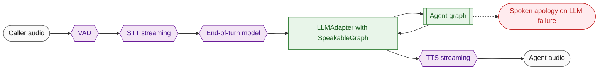
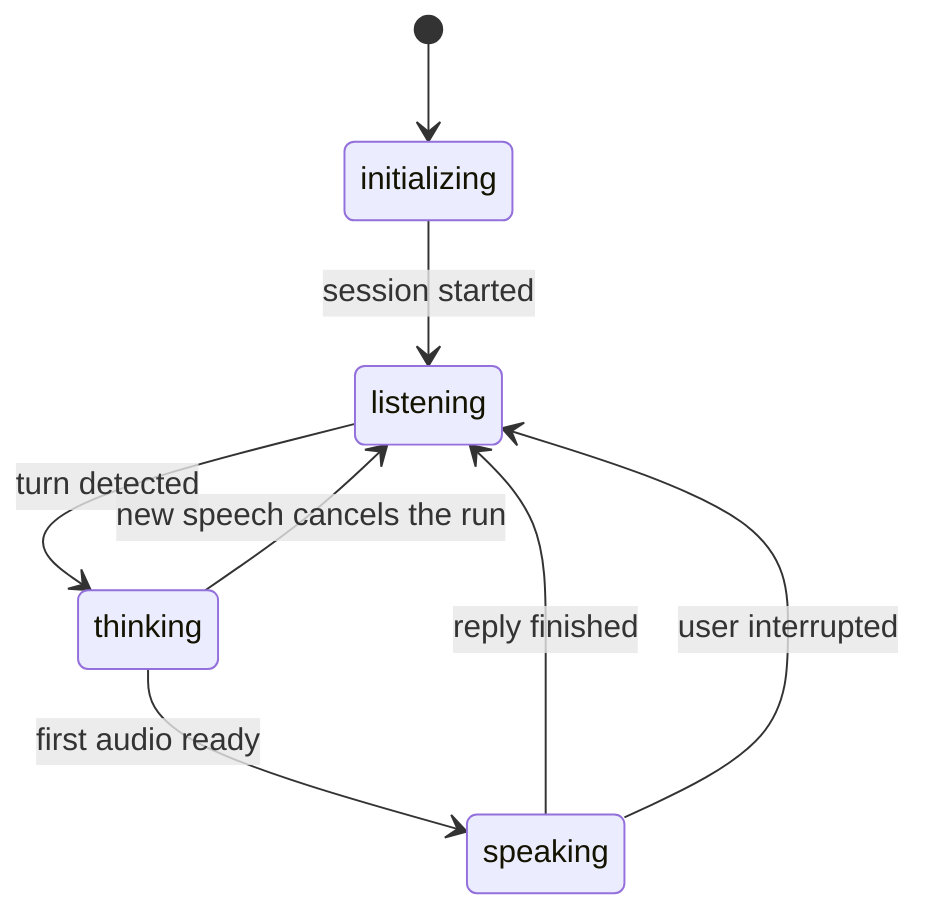

# 10 Voice worker

**What this block is:** `src/voice/` (`worker.py`, `session.py`, `speakable.py`): the program that joins a room and holds the conversation: listen, decide the user is done, think, speak. **Assumes:** [09](09-livekit.md) (rooms and dispatch), [06](06-agent-graph.md) (the graph), [05](05-model-layer.md) (the speech wrappers). **Reference:** [voice.md](../voice.md).

## 1. The problem

A voice agent is a real-time pipeline with hard problems that text chat never has: when has the person *finished* talking (a pause is not an ending), what if they interrupt, how to start speaking before the whole answer exists, and how to stay quiet while a tool runs. The LiveKit Agents framework solves the pipeline mechanics (`AgentSession`); this block configures it and plugs in our LangGraph agent.



## 2. The life of a worker process

`python -m src.voice.worker start` runs `cli.run_app(server)`. LiveKit's CLI handles the commands (`start`, `dev`, `console`, `download-files`). The worker registers with the server and waits ([block 09](09-livekit.md)). Two functions matter:

### `prewarm`: expensive things once

```python
# src/voice/worker.py
def prewarm(proc: JobProcess) -> None:
    """Load the heavy, loop-independent model once per worker process."""
    settings = get_settings()
    setup_logging(settings, exclusive=True)
    proc.userdata[VAD_KEY] = VoiceActivityDetector(settings).load()
    logger.info("Voice worker process ready (VAD loaded)")
```

Loading the Silero VAD model takes a moment and its object is safe to share between calls, so it is loaded once per worker process and stored in `proc.userdata`. It also resets logging with `exclusive=True` because the CLI installs its own handler ([block 02](02-configuration-and-logging.md)).

### `entrypoint`: one call

```python
# src/voice/worker.py
async def entrypoint(ctx: JobContext) -> None:
    """Run one voice session for the room this job was dispatched to."""
    settings = get_settings()
    set_request_id(ctx.room.name)
    runtime = build_runtime(settings)
    ctx.add_shutdown_callback(runtime.aclose)

    speech_to_text = SpeechToText(settings)
    text_to_speech = TextToSpeech(settings)
    turn_detection = TurnDetection(settings)
    vad_model = VoiceActivityDetector(settings)
    await ctx.connect()

    inspector = Inspector(
        ctx.room,
        settings,
        runtime.tracing,
        [
            runtime.llm.info,
            speech_to_text.info,
            text_to_speech.info,
            vad_model.info,
            turn_detection.info,
        ],
    )
    inspector.start()
    ctx.add_shutdown_callback(inspector.aclose)

    config = build_run_config(
        settings,
        runtime.tracing,
        session_id=ctx.room.name,
        request_id=ctx.job.id,
        handlers=[inspector.graph_handler()],
        tags=[VOICE_TAG],
    )
    session = build_session(
        stt_plugin=speech_to_text.build(),
        tts_plugin=text_to_speech.build(),
        vad_plugin=ctx.proc.userdata[VAD_KEY],
        llm_plugin=langchain.LLMAdapter(SpeakableGraph(runtime.build_graph()), config=config),
        turn_handling=turn_detection.options(),
    )
    inspector.attach(session)
    install_error_fallback(session)
    await session.start(agent=OmniAgent(settings.AGENT_GREETING), room=ctx.room)
    logger.info("Voice session started in room %s", ctx.room.name)
```

Read it top to bottom as a recipe:

1. **Log context**: the request id for this job is the room name.
2. **A fresh `Runtime` per job** (LLM client, embeddings, Qdrant, tools). Not shared across jobs because each job runs on its own event loop and async clients are tied to the loop that created them (the "Event loop is closed" bug, [block 05](05-model-layer.md)). `ctx.add_shutdown_callback(runtime.aclose)` closes them at the end.
3. **`await ctx.connect()`** joins the room. The Inspector needs a connected room to publish data.
4. **Inspector** is created and started; it announces the models in use.
5. **Run config** with the Inspector's callback handler, so graph steps become trace events ([block 11](11-inspector.md)).
6. **`build_session`** assembles the pipeline from the pieces: STT plugin, TTS plugin, the shared VAD, the LLM adapter around the graph, and turn handling options.
7. **`inspector.attach` and `install_error_fallback`** hook session events.
8. **`session.start`** begins listening; `OmniAgent.on_enter` speaks the greeting.

## 3. The session

```python
# src/voice/session.py
def build_session(
    *,
    stt_plugin: stt.STT,
    tts_plugin: tts.TTS,
    vad_plugin: vad.VAD,
    llm_plugin: llm.LLM,
    turn_handling: object,
) -> AgentSession:
    """Create the session: VAD -> STT -> turn detection -> LLM adapter -> TTS."""
    return AgentSession(
        stt=stt_plugin,
        tts=tts_plugin,
        vad=vad_plugin,
        llm=llm_plugin,
        turn_handling=turn_handling,
    )
```

`AgentSession` is LiveKit's pipeline object. It receives audio frames and runs: VAD to find speech, STT to produce text, the turn detector to decide the user is done, the LLM to answer, TTS to speak, and the output audio back to the room. Each stage streams: STT emits partial transcripts while you talk; the LLM emits tokens while it thinks; TTS starts speaking when the first sentence is ready.

Non-streaming STT servers (the `openai` provider) are wrapped by the session using the VAD to cut speech into segments, which is why the VAD is always passed in.

### The greeting

```python
# src/voice/session.py
class OmniAgent(Agent):
    """Greets the caller. All instructions live in the graph's prompt, not here."""

    def __init__(self, greeting: str) -> None:
        super().__init__(instructions="")
        self._greeting = greeting

    async def on_enter(self) -> None:
        """Speak the greeting as soon as the agent is active."""
        self.session.say(self._greeting)
```

The agent has **no instructions of its own** (`instructions=""`): the graph's prompt owns behavior. Its only job is to speak `AGENT_GREETING` when it becomes active. If the caller speaks during the greeting they interrupt it, which you can see as a shortened greeting message in the Inspector: that is barge-in working.

## 4. Turn taking, the hard part

| Setting | What it does |
| --- | --- |
| `TURN_DETECTOR=audio` | LiveKit's local **end-of-turn model** looks at the audio and the pause and decides "finished" or "still thinking". |
| `MIN_ENDPOINTING_DELAY` | the shortest silence before a reply may start |
| `MAX_ENDPOINTING_DELAY` | the longest wait when the model believes the user is not done |
| `VAD_MIN_SILENCE_DURATION` and the other `VAD_*` settings | how long silence must last for VAD to report the end of speech, and how sure it must be that something is speech |
| `ALLOW_INTERRUPTIONS` | whether the caller can talk over the agent (detected with VAD) |
| `PREEMPTIVE_GENERATION=false` | do not start the LLM before the turn is confirmed: otherwise a tool such as web search could run twice when the user continues |

The wrapper that turns these into LiveKit options is in [block 05](05-model-layer.md). In a live test with real ElevenLabs speech, the turn was detected about 0.85 s after the caller stopped, and the spoken reply began 3.6 s after the caller stopped, with a knowledge-base lookup in between.

The agent's state machine, as the Inspector shows it:



## 5. `SpeakableGraph`: why the caller does not hear search results

LiveKit's LangChain adapter turns **every message the graph streams** into speech. In LangGraph's `messages` stream, the finished `ToolMessage` of each tool call is also streamed, and the adapter drops the metadata that says which node produced it. The first working call therefore read the raw `<web_result>` text aloud. The fix is a thin wrapper between the graph and the adapter:

```python
# src/voice/speakable.py
def is_speakable(item: Any) -> bool:
    """True for a ``(message, metadata)`` pair that holds assistant text from the agent node."""
    if not (isinstance(item, tuple) and len(item) == 2):
        return False
    message, metadata = item
    from_agent = isinstance(metadata, dict) and metadata.get("langgraph_node") == NODE_AGENT
    return from_agent and isinstance(message, AIMessage | AIMessageChunk)
```

```python
# src/voice/speakable.py (SpeakableGraph._speakable)
async def _speakable(self, stream: AsyncIterator[Any]) -> AsyncIterator[Any]:
    async with aclosing(stream):
        async for item in stream:
            if is_speakable(item):
                yield item
```

Only assistant text from the `agent` node passes. `tests/voice/test_speakable.py` drives the **real** adapter with a scripted graph, and one test documents the broken behavior without the filter so nobody removes it by accident.

## 6. When the LLM fails

If the model fails permanently (quota, outage) the session would otherwise go silent. The caller hears a short apology instead:

```python
# src/voice/session.py
def install_error_fallback(session: AgentSession) -> None:
    """Tell the caller when the LLM fails for good, instead of leaving silence."""

    def on_error(event: events.ErrorEvent) -> None:
        error = event.error
        if isinstance(error, llm.LLMError) and not error.recoverable:
            logger.warning("LLM failed permanently, speaking fallback")
            try:
                session.say(ERROR_SPEECH)
            except RuntimeError as exc:
                logger.warning("Fallback speech not possible: %s", exc)

    session.on("error", on_error)
```

The same error also appears in the Inspector with its real message, so a developer sees "429 rate limited" while the caller hears "Sorry, I ran into a problem."

## 7. Mistakes that happened here

| What happened | Cause | Fix |
| --- | --- | --- |
| Search results were read aloud | adapter speaks every streamed message | `SpeakableGraph` |
| Second call failed: "Event loop is closed" | cached HTTP client shared across job event loops | one client per service, a runtime per job |
| Caller heard nothing after an LLM quota error | no fallback | `install_error_fallback` |
| Deprecation warning at session start | `metrics_collected` is deprecated | latency now read from `ChatMessage.metrics` |
| Health port 8081 answered with another app | an IDE owns that port | worker port defaults to 8181 |
| ElevenLabs 402 on the first greeting | default voice not allowed on free plans | default voice Sarah |
| `eot_ms` empty in the Inspector | end-of-turn delay is on the user message's metrics, not the reply's | read both ([block 11](11-inspector.md)) |

## Try it

With real keys: start LiveKit and the API, run `make agent`, open the GUI, press the call button and watch the Inspector while you talk. Compare the Inspector's `eot.detected` and `latency.turn_summary` events with the numbers in [block 01](01-system-map.md#5-where-the-time-goes).

Without ElevenLabs the `openai` provider can point at any OpenAI-format audio server, which is how this block was verified end to end. [Block 13](13-testing.md#7-testing-the-voice-path-without-elevenlabs) explains the technique (a fake server, a worker pointed at it, and a scripted participant that speaks a recorded question).

## Modify it

- **Different greeting:** `AGENT_GREETING` in `.env`.
- **Snappier turns:** lower `MIN_ENDPOINTING_DELAY` and `MAX_ENDPOINTING_DELAY` a little, set the LLM's thinking off ([block 05](05-model-layer.md)).
- **A new spoken fallback line:** `ERROR_SPEECH` in `src/prompts/agent.py`.

## Check yourself

- Why is the VAD model created in `prewarm` but the LLM client in `entrypoint`?
- Which stage decides that a pause is not the end of a sentence?
- What would a caller hear if `SpeakableGraph` were removed?
- Why is `PREEMPTIVE_GENERATION` off by default for an agent that has tools?

## Read next

[11 Inspector](11-inspector.md), the events this worker emits.
