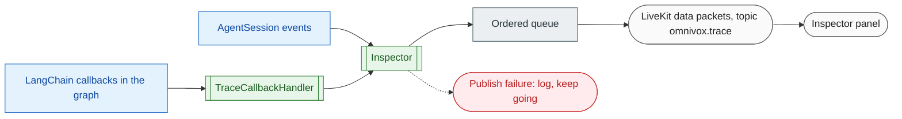

# 11 Inspector

**What this block is:** the machinery that exposes the agent's internal steps (VAD, speech recognition, end of turn, graph nodes, tool calls, model timing, latency) as typed events the GUI can draw. Files: `src/utils/trace_events.py`, `src/graph/trace.py`, `src/voice/inspector.py`. **Assumes:** [06](06-agent-graph.md) and [10](10-voice-worker.md). **GUI side:** [12](12-frontend.md). **Event catalog:** [voice.md](../voice.md#inspector).

## 1. The problem

When a voice agent answers wrongly or slowly you need to know *which stage* is to blame. Was the transcript wrong? Did the end-of-turn model wait three seconds? Did the search take four? Did the model call a tool at all? Logs scatter this over several processes. The Inspector turns each step into a small event with a timestamp and a turn number and sends it to the browser in real time.



There are two **producers** of events and one **transport**:

| Producer | Sees | Emits |
| --- | --- | --- |
| `Inspector` (session events) | VAD state, transcripts, agent state, messages, per-turn metrics, errors | `vad.*`, `stt.*`, `session.*`, `eot.*`, `tts.*`, `latency.*`, `error.*` |
| `TraceCallbackHandler` (LangChain callbacks) | graph nodes, routing, LLM calls, tool calls | `graph.*`, `llm.*`, `tool.*` |

The text chat API reuses the second producer (through the SSE stream, [block 06](06-agent-graph.md)); the browser then maps those frames onto the same shape ([block 12](12-frontend.md)), so voice and chat render identically.

## 2. The event: one shape for everything

```python
# src/utils/trace_events.py
class TraceEvent:
    """One inspector event. ``to_dict`` is the wire format sent over the LiveKit data channel."""

    source: TraceSource
    type: str
    label: str
    data: dict[str, Any] = field(default_factory=dict)
    duration_ms: float | None = None
    turn: int = 0
    ts: int = field(default_factory=lambda: int(time.time() * 1000))
    id: str = field(default_factory=lambda: uuid.uuid4().hex[:12])

    def to_dict(self) -> dict[str, Any]:
        """Wire representation (``v`` is the schema version)."""
        payload: dict[str, Any] = {
            "v": TRACE_VERSION,
            "id": self.id,
            "ts": self.ts,
            "turn": self.turn,
            "source": self.source,
            "type": self.type,
            "label": self.label,
            "data": self.data,
        }
        if self.duration_ms is not None:
            payload["duration_ms"] = round(self.duration_ms, 1)
        return payload
```

Fields: `source` (which subsystem), `type` (what happened), `label` (a human sentence), `data` (details), `duration_ms` (when it measures something), `turn` (which question of the call), `ts` (milliseconds since epoch) and a short random `id` (so the browser can drop duplicates). `to_dict()` is the wire format; `v` is a schema version so the format can evolve.

New event kinds need **no change** in the transport and none in the browser, which draws unknown types with a generic row. That tolerance is deliberate: producer and GUI can be upgraded independently.

## 3. Graph events: `TraceCallbackHandler`

LangChain and LangGraph call **callbacks** at every start and end of a run: chain, LLM call, tool call. The handler turns those into events. Look at how a node boundary is recognized and how timing is kept:

```python
# src/graph/trace.py (TraceCallbackHandler.on_chain_start)
async def on_chain_start(
    self,
    serialized: dict[str, Any] | None,
    inputs: Any,
    *,
    run_id: UUID,
    parent_run_id: UUID | None = None,
    tags: list[str] | None = None,
    metadata: dict[str, Any] | None = None,
    **kwargs: Any,
) -> None:
    name = kwargs.get("name")
    node = (metadata or {}).get("langgraph_node")
    if node and name == node:
        self._nodes[run_id] = _Timer(node)
        await self._emit(
            TraceEvent("graph", "node_start", f"Node {node} started", {"node": node})
        )
    elif name == ROUTER_AFTER_AGENT:
        self._routers[run_id] = _Timer(name)
```

```python
# src/graph/trace.py (TraceCallbackHandler.on_chain_end)
async def on_chain_end(
    self, outputs: Any, *, run_id: UUID, parent_run_id: UUID | None = None, **kwargs: Any
) -> None:
    if timer := self._nodes.pop(run_id, None):
        await self._emit(
            TraceEvent(
                "graph",
                "node_end",
                f"Node {timer.name} finished",
                {"node": timer.name},
                duration_ms=timer.elapsed_ms(),
            )
        )
    elif (router := self._routers.pop(run_id, None)) is not None:
        target = outputs if isinstance(outputs, str) else str(outputs)
        await self._emit(
            TraceEvent(
                "graph",
                "route",
                f"Route {NODE_AGENT} -> {target}",
                {"from": NODE_AGENT, "to": target},
                duration_ms=router.elapsed_ms(),
            )
        )
```

- A run is a **graph node** when its `name` equals `metadata["langgraph_node"]`; inner runs (the prompt template, for example) share the metadata but have other names and are skipped.
- The conditional router (`route_after_agent`) is its own run; its output is the next node, which becomes a `graph.route` event. It fires **before** the node's `node_end`, because the router executes inside the node's run.
- `_Timer` objects keyed by `run_id` give `duration_ms`.
- Tool arguments and results are cut to `INSPECTOR_MAX_FIELD_CHARS` (default 1500) with `truncate`.
- **Cancellation is not an error.** When the caller speaks again, LiveKit cancels the running reply. The handler reports `graph.node_cancelled`, `llm.cancelled`, `tool.cancelled` instead of an error:

```python
# src/graph/trace.py (TraceCallbackHandler.on_tool_error)
async def on_tool_error(
    self,
    error: BaseException,
    *,
    run_id: UUID,
    parent_run_id: UUID | None = None,
    **kwargs: Any,
) -> None:
    timer = self._tools.pop(run_id, None) or _Timer("tool")
    if isinstance(error, CANCELLATIONS):
        await self._emit(
            TraceEvent(
                "tool",
                "cancelled",
                f"Tool {timer.name} cancelled",
                {"name": timer.name},
                duration_ms=timer.elapsed_ms(),
            )
        )
        return
    await self._emit(
        TraceEvent(
            "tool",
            "error",
            f"Tool {timer.name} failed",
            {"name": timer.name, "message": self._clip(f"{type(error).__name__}: {error}")},
            duration_ms=timer.elapsed_ms(),
        )
    )
```

The handler has `run_inline = True`, which makes callbacks run in order in the same task; without it events could be emitted out of order.

## 4. Session events: `Inspector`

`Inspector.attach(session)` subscribes to the `AgentSession` events (`user_state_changed`, `agent_state_changed`, `user_input_transcribed`, `conversation_item_added`, `agent_false_interruption`, `error`, `close`) and converts them.

### Turns

A *turn* is one question and its answer. The counter increases when the user starts speaking **and** the previous turn is closed; the turn closes when the agent stops speaking. A pause in the middle of a question therefore stays in the same turn:

```python
# src/voice/inspector.py (Inspector._on_user_state)
def _on_user_state(self, event: events.UserStateChangedEvent) -> None:
    if event.new_state == "speaking" and not self._turn_open:
        self._turn += 1
        self._turn_open = True
    self.emit(
        TraceEvent(
            "vad",
            "user_state",
            f"User {event.new_state}",
            {"state": event.new_state, "previous": event.old_state},
        )
    )
```

Events created before the user speaks (the greeting) belong to turn 0.

### Latency

LiveKit puts timing on the messages it records. The **user's** message carries how long the end-of-turn model waited; the **assistant's** message carries model first-token time, TTS first-audio time, and the end-to-end latency. The Inspector joins the two:

```python
# src/voice/inspector.py (Inspector._user_metrics)
def _user_metrics(self, metrics: Mapping[str, Any]) -> None:
    """Report how long the end-of-turn model waited after the user stopped talking."""
    eot = _ms(metrics.get("end_of_turn_delay"))
    transcription = _ms(metrics.get("transcription_delay"))
    self._pending_eot = (eot, transcription)
    if eot is not None:
        self.emit(
            TraceEvent(
                "eot",
                "detected",
                "End of turn",
                {"delay_ms": eot, "transcript_delay_ms": transcription},
                duration_ms=eot,
            )
        )
```

```python
# src/voice/inspector.py (Inspector._turn_metrics)
def _turn_metrics(self, metrics: Mapping[str, Any]) -> None:
    """Report the TTS and total latency LiveKit measured for the reply."""
    eot, _ = self._pending_eot
    self._pending_eot = (None, None)
    ttft = _ms(metrics.get("llm_node_ttft"))
    ttfb = _ms(metrics.get("tts_node_ttfb"))
    total = _ms(metrics.get("e2e_latency"))
    if ttfb is not None:
        self.emit(
            TraceEvent("tts", "first_audio", "First audio", {"ttfb_ms": ttfb}, duration_ms=ttfb)
        )
    if eot is None and total is None:
        return  # no user turn behind this reply (the greeting), nothing to summarize
    summary = {
        "eot_ms": eot,
        "llm_ttft_ms": ttft,
        "tts_ttfb_ms": ttfb,
        "total_ms": total,
        "playback_ms": _ms(metrics.get("playback_latency")),
    }
    self.emit(TraceEvent("latency", "turn_summary", "Turn latency", summary, duration_ms=total))
    self._record_turn(summary, total)
```

`eot_ms` is the wait after the user stopped speaking, `llm_ttft_ms` the time to the model's first token, `tts_ttfb_ms` the time to the first audio byte, and `total_ms` from the end of speech to the start of the reply. A reply with no user turn (the greeting) reports `tts.first_audio` only. Unmeasured values are `null`, never negative. The same summary is also recorded as a LangSmith run named `voice.turn`, so speech timing sits next to the model trace.

## 5. The transport

`emit` never blocks: it puts the event on a queue. One background task takes events in order and publishes each as a **reliable data packet** with topic `omnivox.trace`:

```python
# src/voice/inspector.py (Inspector._publish_loop)
async def _publish_loop(self) -> None:
    while (item := await self._queue.get()) is not _STOP:
        payload = self._encode(item)
        try:
            await self._room.local_participant.publish_data(
                payload, reliable=True, topic=TRACE_TOPIC
            )
        except Exception as exc:
            logger.warning("Inspector publish failed: %s: %s", type(exc).__name__, exc)
```

A failed publish is logged and the loop continues: tracing must never take a call down. A data packet may not exceed about 15 KB, so an oversized event is replaced by a version without data:

```python
# src/voice/inspector.py (Inspector._encode)
def _encode(event: TraceEvent) -> bytes:
    payload = json.dumps(event.to_dict(), ensure_ascii=False).encode()
    if len(payload) > MAX_PACKET_BYTES:
        slim = TraceEvent(
            event.source,
            event.type,
            event.label,
            {"truncated": True},
            event.duration_ms,
            event.turn,
            event.ts,
            event.id,
        )
        payload = json.dumps(slim.to_dict()).encode()
    return payload
```

## 6. What goes where, and privacy

- Transcripts and tool results are sent **only to participants of that room**, i.e. the person on the call.
- Server logs above DEBUG hold sizes and ids, never the transcripts ([block 02](02-configuration-and-logging.md)).
- `INSPECTOR_ENABLED=false` disables publishing entirely; `INSPECTOR_MAX_FIELD_CHARS` limits any single value.

## 7. Mistakes that happened here

| What happened | Cause | Fix |
| --- | --- | --- |
| Cancelled runs appeared as errors | the user interrupted, LangGraph raised `CancelledError` | separate `*_cancelled` events |
| `latency.turn_summary` fired on the greeting with nulls | the greeting has no user turn | no summary without `eot_ms` or `total_ms` |
| `eot_ms` stayed `null` | the delay is on the *user* message metrics | `_user_metrics` stores it for the reply |
| Deprecation warning at startup | `metrics_collected` event is deprecated | read `ChatMessage.metrics` |

## Try it

```bash
uv run pytest tests/voice/test_inspector.py tests/graph/test_trace.py -q
```

Read `test_a_turn_reports_eot_from_the_user_message_and_the_summary_from_the_reply`: it feeds two `ChatMessage` objects through a fake session and shows the exact events and numbers. For a live view run the stack and open the Inspector panel while talking.

## Modify it: add an event end to end

Say you want an event when a tool is slow:

1. In `TraceCallbackHandler.on_tool_end` emit a second `TraceEvent("tool", "slow", "Tool was slow", {...})` when `elapsed_ms() > 3000`.
2. Add a row to the table in `docs/voice.md`.
3. Test it in `tests/graph/test_trace.py` by running a fake tool that sleeps.
4. Optional: a friendlier summary in `frontend/src/inspector/describe.ts`. Without it the GUI already shows the event with its fields.

## Check yourself

- Why does `graph.route` appear before `graph.node_end` for the agent node?
- A caller says one sentence, pauses for two seconds and continues. How many turns does the Inspector count, and why?
- What happens to an event whose JSON exceeds the packet limit?
- Why is the end-of-turn delay read from the user's message rather than the reply's?

## Read next

[12 Frontend](12-frontend.md), which consumes these events.
