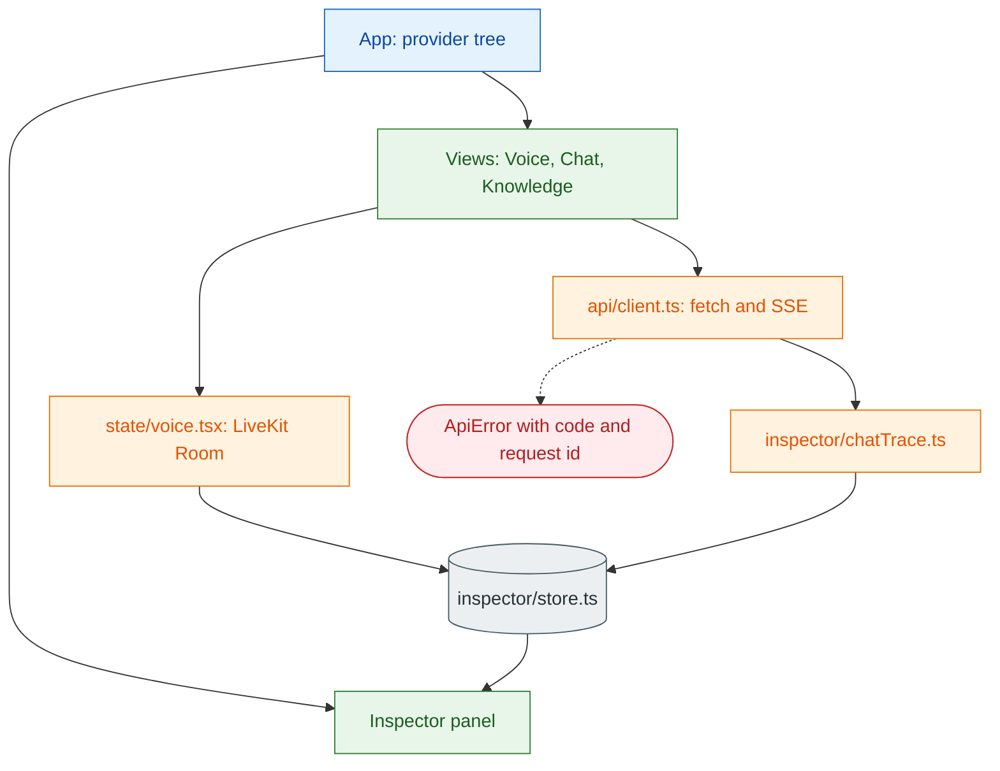

# 12 Frontend

**What this block is:** `frontend/`: a React and TypeScript single-page app with three views (Voice, Chat, Knowledge) and the Inspector panel. **Assumes:** [03](03-api-layer.md) (the endpoints it calls), [09](09-livekit.md) (rooms and tokens), [11](11-inspector.md) (the events it draws). **Quick reference:** [frontend.md](../frontend.md).

## 1. Stack and shape

Vite builds it, React 19 renders it, TypeScript runs in `strict` mode, `livekit-client` and `@livekit/components-react` handle the call, plain CSS with design tokens does the styling. There is **no UI framework and no state library**: state lives in React context providers and one small external store.



```text
frontend/src/
  App.tsx            provider tree and the shell layout
  api/               types.ts (every wire type), client.ts (fetch, errors, SSE)
  state/             settings, toast, layout, chat, voice (LiveKit)
  inspector/         store.ts (event store), chatTrace.ts, describe.ts, Timeline, Waterfall, Inspector
  views/             VoiceView, ChatView, KnowledgeView
  components/        Header, Rail, Orb (canvas), Markdown, ErrorBanner, CopyButton
  hooks/             useServerStatus (health and info polling), useTraceTranscript, useMediaQuery
  styles/            tokens.css (colors, themes), base.css, layout.css, one file per view
  dev/               DemoProvider (sample call replay, development only)
scripts/             mock-server.mjs (a fake backend for development)
```

## 2. The provider tree

Providers wrap the app in the order their dependencies need:

<!-- excerpt: frontend/src/App.tsx#App -->
```tsx
// frontend/src/App.tsx (App)
export function App() {
  return (
    <SettingsProvider>
      <ToastProvider>
        <LayoutProvider>
          <Dev>
            <ChatProvider>
              <VoiceProvider>
                <Shell />
              </VoiceProvider>
            </ChatProvider>
          </Dev>
        </LayoutProvider>
      </ToastProvider>
    </SettingsProvider>
  );
}
```

`Settings` (theme, API key) and `Toast` come first because everything may use them; `Layout` (current view, inspector size) next; then `Chat`, then `Voice`. `Voice` is **above the views**, so the LiveKit `Room` lives for the whole app: you can switch from Voice to Knowledge in the middle of a call and the call continues.

<!-- excerpt: frontend/src/App.tsx#Shell -->
```tsx
// frontend/src/App.tsx (Shell)
function Shell() {
  const { view } = useLayout();
  return (
    <div className="app">
      <a className="skip-link" href="#main" onClick={(e) => (e.preventDefault(), document.getElementById("main")?.focus())}>
        Skip to content
      </a>
      <Rail />
      <Header />
      <main id="main" className="main" tabIndex={-1} key={view}>
        {view === "voice" && <VoiceView />}
        {view === "chat" && <ChatView />}
        {view === "knowledge" && <KnowledgeView />}
      </main>
      <Inspector />
    </div>
  );
}
```

The `Inspector` is a sibling of `main`, not a child of a view, so it also survives view switches and keeps its events.

## 3. Talking to the API: `api/client.ts`

All requests use **relative URLs** (`/api/v1/...`). In development Vite proxies `/api` and `/health` to `VITE_API_BASE_URL` (default `http://localhost:8100`); in production nginx does the same. The browser therefore sees one origin and CORS never matters.

### Errors become one type

The API always answers errors with `{"error": {code, message, request_id}}`. The client turns that into `ApiError`; anything that is *not* our envelope (a proxy page, a 502 when the backend is down) is mapped to a friendly "API is unreachable":

<!-- excerpt: frontend/src/api/client.ts#toApiError -->
```typescript
// frontend/src/api/client.ts (toApiError)
async function toApiError(res: Response): Promise<ApiError> {
  const headerId = res.headers.get("X-Request-ID") ?? undefined;
  let body: unknown;
  const text = await res.text().catch(() => "");
  try {
    body = text ? JSON.parse(text) : undefined;
  } catch {
    body = undefined;
  }
  const err = (body as Partial<ApiErrorBody> | undefined)?.error;
  if (err && typeof err.message === "string") {
    return new ApiError({
      status: res.status,
      code: err.code ?? "error",
      message: err.message,
      requestId: err.request_id || headerId,
      details: err.details,
    });
  }
  // Not our error envelope: a proxy failure, an HTML page, FastAPI's default {"detail"}, etc.
  const detail = (body as { detail?: unknown } | undefined)?.detail;
  const proxyDown = res.status === 502 || res.status === 503 || res.status === 504 || (res.status === 500 && !text);
  const message = proxyDown
    ? "The API is unreachable. Is the backend running?"
    : typeof detail === "string"
      ? `${detail} (HTTP ${res.status})`
      : `Request failed with HTTP ${res.status}${res.statusText ? ` ${res.statusText}` : ""}.`;
  return new ApiError({
    status: res.status,
    code: proxyDown ? "unreachable" : "http_error",
    message,
    requestId: headerId,
    details: detail ?? (text && text.length < 500 ? text : undefined),
  });
}
```

The UI shows the message and the `request_id`, so a user can quote the id and you can find the log lines ([block 03](03-api-layer.md)).

### Streaming without `EventSource`

`EventSource` can only send GET requests; the chat stream needs a POST body, so the client reads the response body as a stream and parses SSE itself. The parser keeps a buffer, splits on blank lines (LF, CRLF or CR), joins multi-line `data:`, ignores `:` comment lines, and maps the five known event names to typed frames:

<!-- excerpt: frontend/src/api/client.ts#SseParser -->
```typescript
// frontend/src/api/client.ts (SseParser)
export class SseParser {
  private buffer = "";

  push(chunk: string): StreamFrame[] {
    this.buffer += chunk;
    const frames: StreamFrame[] = [];
    // Frames are separated by a blank line (LF, CRLF or CR).
    const parts = this.buffer.split(/\r\n\r\n|\n\n|\r\r/);
    this.buffer = parts.pop() ?? "";
    for (const part of parts) {
      const frame = parseFrame(part);
      if (frame) frames.push(frame);
    }
    return frames;
  }

  /** Flush a trailing frame that was not terminated by a blank line. */
  end(): StreamFrame[] {
    const rest = this.buffer;
    this.buffer = "";
    const frame = rest.trim() ? parseFrame(rest) : null;
    return frame ? [frame] : [];
  }
}
```

<!-- excerpt: frontend/src/api/client.ts#streamAgent -->
```typescript
// frontend/src/api/client.ts (streamAgent)
export async function streamAgent(
  body: AgentRequest,
  onFrame: (frame: StreamFrame) => void,
  signal?: AbortSignal,
): Promise<void> {
  const res = await send("/api/v1/agent/stream", {
    method: "POST",
    headers: headers({ "Content-Type": "application/json", Accept: "text/event-stream" }),
    body: JSON.stringify(body),
    signal,
  });
  if (!res.body) {
    throw new ApiError({
      status: res.status,
      code: "no_stream",
      message: "The browser did not expose a response stream.",
      requestId: res.headers.get("X-Request-ID") ?? undefined,
    });
  }
  const reader = res.body.getReader();
  const decoder = new TextDecoder();
  const parser = new SseParser();
  try {
    for (;;) {
      const { done, value } = await reader.read();
      if (done) break;
      for (const f of parser.push(decoder.decode(value, { stream: true }))) onFrame(f);
    }
    for (const f of parser.push(decoder.decode())) onFrame(f);
    for (const f of parser.end()) onFrame(f);
  } finally {
    reader.releaseLock();
  }
}
```

`AbortController` cancels the fetch when the user presses Stop: the server notices the closed connection and cancels the graph ([block 06](06-agent-graph.md)).

## 4. The Inspector store

Events arrive from two places (the LiveKit data channel, and the chat tracer) at up to a few per millisecond. One store receives them all. It is a plain class used through React's `useSyncExternalStore`:

<!-- excerpt: frontend/src/inspector/store.ts#normalizeTrace -->
```typescript
// frontend/src/inspector/store.ts (normalizeTrace)
export function normalizeTrace(raw: unknown): TraceEvent | null {
  if (!isRecord(raw)) return null;
  const source = typeof raw.source === "string" && raw.source ? raw.source : null;
  const type = typeof raw.type === "string" && raw.type ? raw.type : null;
  if (!source || !type) return null;
  const ts = num(raw.ts);
  const turn = num(raw.turn);
  const duration = num(raw.duration_ms);
  return {
    v: num(raw.v) ?? 1,
    id: typeof raw.id === "string" && raw.id ? raw.id : randomId("evt"),
    ts: ts ?? Date.now(),
    turn: turn != null ? Math.trunc(turn) : 0,
    source,
    type,
    label: typeof raw.label === "string" && raw.label ? raw.label : `${source}.${type}`,
    ...(duration != null ? { duration_ms: duration } : {}),
    data: isRecord(raw.data) ? raw.data : raw.data === undefined ? {} : { value: raw.data },
  };
}
```

- **Tolerant normalization:** anything that has a string `source` and `type` becomes an event; missing fields get defaults; unknown kinds are kept. A newer backend never breaks an older GUI.
- **Deduplication** by `run:id` so a replayed packet is not shown twice.
- **A cap of 6000 events**, oldest dropped (with a counter shown to the user).
- **Pause** buffers new events without losing them; **resume** flushes.
- **Notifications are coalesced to about 25 per second** (a 40 ms timer), so a burst of events causes one React render, not hundreds.

<!-- excerpt: frontend/src/inspector/store.ts#ingest -->
```typescript
// frontend/src/inspector/store.ts (ingest)
ingest(raw: unknown, run: number, origin: Origin): InspectorEvent | null {
  const t = normalizeTrace(raw);
  if (!t) {
    this.malformed++;
    this.touch();
    return null;
  }
  const dedupe = `${run}:${t.id}`;
  if (this.seen.has(dedupe)) return null;
  this.seen.add(dedupe);

  const event: InspectorEvent = { ...t, seq: this.nextSeq++, run, origin, groupKey: `${run}:${t.turn}` };
  for (const l of this.eventListeners) l(event);
  if (this.paused) this.pending.push(event);
  else this.commit([event]);
  this.touch();
  return event;
}
```

Events are then **grouped into turn cards** (one per `run:turn`), where a *run* is one call or one chat session:

<!-- excerpt: frontend/src/inspector/store.ts#groupEvents -->
```typescript
// frontend/src/inspector/store.ts (groupEvents)
export function groupEvents(events: readonly InspectorEvent[], runs: readonly Run[]): TurnGroup[] {
  const runLabel = new Map(runs.map((r) => [r.id, r.label]));
  const groups = new Map<string, TurnGroup>();
  for (const e of events) {
    let g = groups.get(e.groupKey);
    if (!g) {
      g = {
        key: e.groupKey,
        run: e.run,
        turn: e.turn,
        origin: e.origin,
        runLabel: runLabel.get(e.run) ?? "",
        events: [],
        startTs: e.ts,
        endTs: e.ts,
        hasError: false,
        toolCount: 0,
      };
      groups.set(e.groupKey, g);
    }
    g.events.push(e);
    g.startTs = Math.min(g.startTs, e.ts);
    g.endTs = Math.max(g.endTs, e.ts + (e.duration_ms ?? 0));
    if (e.source === "error" || (e.source === "tool" && e.type === "error")) g.hasError = true;
    if (e.source === "tool" && e.type === "start") g.toolCount++;
    if (e.source === "stt" && e.type === "final" && typeof e.data.text === "string") g.userText = e.data.text;
    if (e.source === "session" && e.type === "user_message" && typeof e.data.text === "string") g.userText = e.data.text;
    if (e.source === "latency" && e.type === "turn_summary") g.summary = readSummary(e.data);
  }
  const out = [...groups.values()];
  for (const g of out) g.events.sort((a, b) => a.ts - b.ts || a.seq - b.seq);
  return out;
}
```

## 5. Voice: one Room, many hooks

`state/voice.tsx` creates the `Room` once (echo cancellation, noise suppression and auto gain on) and offers a single `VoiceSession` object to the Voice view. The connect flow is the client half of [block 09](09-livekit.md):

<!-- excerpt: frontend/src/state/voice.tsx:L279-313 -->
```tsx
// frontend/src/state/voice.tsx
const connect = useCallback(async () => {
  if (room.state !== ConnectionState.Disconnected) return;
  setError(null);
  setWarning(null);
  setConnecting(true);

  let token: TokenResponse;
  try {
    token = await api.livekitToken({});
  } catch (e) {
    const ui = toUiError(e);
    setError({ ...ui, message: `Could not get a LiveKit token. ${ui.message}` });
    setConnecting(false);
    return;
  }

  startRun();
  trace.reset();
  setRoomName(token.room);
  try {
    await room.connect(token.url, token.token);
  } catch (e) {
    setError(connectionErrorMessage(e, token.url));
    setConnecting(false);
    await room.disconnect().catch(() => undefined);
    return;
  }
  try {
    await room.localParticipant.setMicrophoneEnabled(true);
  } catch (e) {
    setError({ message: micErrorMessage(e), code: "microphone" });
    await room.disconnect().catch(() => undefined);
  }
  setConnecting(false);
}, [room, startRun, trace]);
```

Reading it: get a token from the API (`api.livekitToken`), start an Inspector run, join with `room.connect(url, token)`, then turn the microphone on. Each step reports its own friendly error (token failure, unreachable server, rejected token, denied microphone).

**Agent state** comes from LiveKit (the agent's participant attribute `lk.agent.state`, via `useVoiceAssistant`) and is mapped to the UI's states. As a fallback, if the attribute has not arrived yet, the latest `session.agent_state` trace event is used:

<!-- excerpt: frontend/src/state/voice.tsx#mapAgentState -->
```tsx
// frontend/src/state/voice.tsx (mapAgentState)
function mapAgentState(connection: ConnectionState, agentState: string): VoiceState {
  if (connection === ConnectionState.Disconnected) return "disconnected";
  if (connection !== ConnectionState.Connected) return "connecting";
  switch (agentState) {
    case "listening":
    case "thinking":
    case "speaking":
    case "idle":
    case "failed":
      return agentState;
    default:
      // initializing / connecting / pre-connect-buffering / disconnected (agent not in the room yet)
      return "initializing";
  }
}
```

**Transcript:** the user's lines are built from `stt.interim` and `stt.final` trace events (an interim line is revised in place, the final commits it); the agent's lines come from LiveKit text streams (`useTranscriptions`):

<!-- excerpt: frontend/src/hooks/useTraceTranscript.ts#useTraceTranscript -->
```typescript
// frontend/src/hooks/useTraceTranscript.ts (useTraceTranscript)
export function useTraceTranscript(origin: Origin, run: number | null) {
  const [entries, setEntries] = useState<TranscriptEntry[]>([]);
  /** True once any stt event arrived for this run (so streams need not double-render the user). */
  const sawStt = useRef(false);
  const [saw, setSaw] = useState(false);

  useEffect(() => {
    if (run == null) return;
    return inspectorStore.onEvent((e) => {
      if (e.origin !== origin || e.run !== run || e.source !== "stt") return;
      const text = typeof e.data.text === "string" ? e.data.text : "";
      if (e.type !== "interim" && e.type !== "final") return;
      if (!sawStt.current) {
        sawStt.current = true;
        setSaw(true);
      }
      const id = `u:${run}:${e.turn}`;
      const final = e.type === "final";
      setEntries((list) => {
        const i = list.findIndex((x) => x.id === id);
        if (i === -1) return [...list, { id, role: "user", text, final, ts: e.ts }];
        const prev = list[i] as TranscriptEntry;
        if (prev.final && !final) return list; // late interim after the final: ignore
        const next = list.slice();
        next[i] = { ...prev, text, final };
        return next;
      });
    });
  }, [origin, run]);

  const reset = useCallback(() => {
    sawStt.current = false;
    setSaw(false);
    setEntries([]);
  }, []);

  return { entries, sawStt: saw, reset };
}
```

**Audio level:** two small analysers write the microphone and agent volume into `ref`s. The orb reads them every animation frame, so the component never re-renders at audio rate. If the agent is not in the room after 20 seconds a warning says to check that the worker is running.

## 6. Chat: the same events from SSE

The chat view calls `streamAgent` and, for every frame, also calls `ChatTracer.frame`, which converts the frame into the **same event shape** the voice pipeline sends, so the Inspector renders both with one code path:

<!-- excerpt: frontend/src/inspector/chatTrace.ts#frame -->
```typescript
// frontend/src/inspector/chatTrace.ts (frame)
frame(f: StreamFrame): void {
  switch (f.event) {
    case "node":
      this.emit(
        "graph",
        f.data.phase === "start" ? "node_start" : "node_end",
        `Node ${f.data.name}`,
        { node: f.data.name },
        f.data.duration_ms,
      );
      break;
    case "tool": {
      const { phase, name, args, result_preview, duration_ms, message } = f.data;
      if (phase === "start") this.emit("tool", "start", `Tool ${name}`, { name, args });
      else if (phase === "end") this.emit("tool", "end", `Tool ${name}`, { name, result_preview }, duration_ms);
      else this.emit("tool", "error", `Tool ${name} failed`, { name, message: message ?? "tool error" }, duration_ms);
      break;
    }
    case "token":
      if (this.ttftMs === undefined) {
        this.ttftMs = Date.now() - this.t0;
        this.emit("llm", "first_token", "First token", { ttft_ms: this.ttftMs, measured: "client" });
      }
      break;
    case "final": {
      const total = Date.now() - this.t0;
      this.emit("session", "final", "Answer complete", {
        session_id: f.data.session_id,
        characters: f.data.answer.length,
      });
      this.emit("latency", "turn_summary", "Turn latency", {
        llm_ttft_ms: this.ttftMs,
        total_ms: total,
        measured: "client",
      });
      break;
    }
    case "error":
      this.emit("error", "error", "Stream error", {
        message: f.data.message,
        source: "agent.stream",
        code: f.data.code,
        request_id: f.data.request_id,
      });
      break;
    default:
      this.emit("session", "unknown_frame", `Unknown SSE frame: ${f.name}`, { event: f.name, data: f.data });
  }
}
```

Timestamps for chat events are measured in the browser (time of arrival) and `ttft_ms` is marked `measured: "client"`, which the latency panel labels as such. Tokens are coalesced into about 30 renders per second.

## 7. Layout, theme, accessibility

- **Routing** is the URL hash (`#/voice`, `#/chat`, `#/knowledge`), with no router library.
- The Inspector is a **docked column** above 1060 px width and a **drawer** below; below 720 px the left rail becomes a bottom tab bar.
- `tokens.css` defines colors for dark (default) and light, honors `prefers-color-scheme`, and a manual toggle stores the choice in `localStorage` through a wrapper that never throws.
- A skip link, a focusable main region, a keyboard-resizable Inspector, and `reducedMotion` support in the orb.

## 8. Development and build

```bash
make frontend-install        # npm ci
make frontend-dev            # http://localhost:5173, proxy to the API
npm run dev:mock             # inside frontend/: a fake backend with a sample call, no real services needed
npm run build                # tsc strict, then vite build into frontend/dist
```

`frontend/scripts/mock-server.mjs` implements the whole API contract and replays a sample call so the Voice and Inspector views can be developed without keys. `?demo&speed=4` starts the replay. The production image (`deployment/Dockerfile.frontend`) builds `dist` and serves it with nginx, which also proxies `/api` ([block 14](14-infrastructure.md)).

## 9. Mistakes that happened here

| What happened | Cause | Fix |
| --- | --- | --- |
| The dev proxy hit another application | the default target was port 8000, owned by an IDE | default `VITE_API_BASE_URL` is `http://localhost:8100` |
| Microphone never started on a plain HTTP page | browsers allow capture only on HTTPS or `localhost` | explicit message from `micErrorMessage` |
| "Agent never joined" looked like a GUI bug | the worker was not running | 20 s warning that names the worker |
| Transcript showed the user's words twice | both trace events and LiveKit streams carried them | prefer trace events once any `stt` event arrived |

## Try it

```bash
cd frontend && npm run dev:mock
```

Open the app, press **Simulate call** and watch the Inspector fill: expand a turn, filter by source, pause and resume, export the JSON. Then stop the mock, run the real API (`make run`) and send a Chat message that triggers a web search: the same panel shows `graph`, `tool` and `llm` events from `ChatTracer`.

## Modify it

- **A new Inspector event** needs no change; to give it a nicer line add a case in `inspector/describe.ts`.
- **A new view:** add a name to `View`/`VIEWS` in `state/layout.tsx`, a component in `views/`, a branch in `Shell`, an entry in `Rail`.
- **A new API call:** a function in `api/client.ts` and its types in `api/types.ts` (keep them in step with `docs/api_integration/schemas/`).

## Check yourself

- Why does a call survive switching from the Voice view to Knowledge?
- Why can the chat stream not use `EventSource`?
- Two events with the same `id` arrive in one run. What happens, and where?
- How does the Inspector show chat and voice with one rendering path?

## Read next

[13 Testing](13-testing.md).
