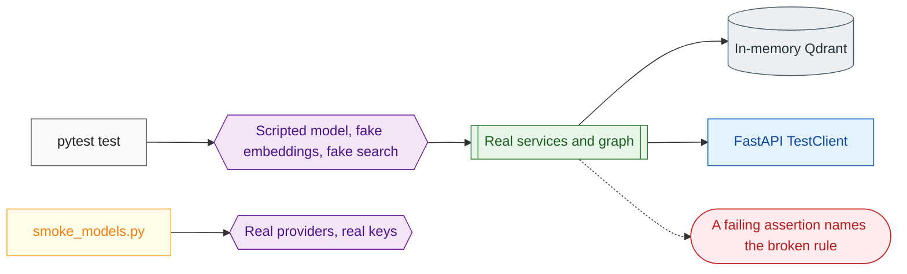

# 13 Testing

**What this block is:** `tests/` and `scripts/`: how the project proves itself without a network, a key or a microphone, and how it checks the real providers when you do have them. **Assumes:** nothing, but the examples refer to [04](04-services.md), [06](06-agent-graph.md) and [11](11-inspector.md).

## 1. The idea in one paragraph

Real model calls are slow, cost money, change from day to day and need secrets. So the test suite never makes one. Instead each boundary has a **fake** with the same interface, the code is built through **injection** so a fake can be passed in, and the fakes are scripted so a test controls exactly what the "model" says. A second, separate kind of check (`scripts/smoke_models.py`) calls the real providers on demand.



Run everything with `make test` (about ten seconds); lint and format with `make lint`; both with `make check`.

## 2. How the folders map to the code

| Test folder | Covers | Typical technique |
| --- | --- | --- |
| `tests/config/` | settings, logging | build `Settings(_env_file=None, ...)`; assert validation errors and redaction |
| `tests/utils/` | text helpers, trace events | plain function tests |
| `tests/ai_models/` | LLM, embeddings, speech factories, tracing | injected fakes; provider errors raised on purpose |
| `tests/clients/`, `tests/rag/` | Qdrant, web search, loaders, retriever | `QDRANT_URL=:memory:` |
| `tests/graph/` | nodes, router, tools, streaming, memory | scripted model, real graph |
| `tests/services/` | chat, knowledge, LiveKit tokens | same, without HTTP |
| `tests/api/` | routes, validation, every error row | `TestClient` over a container of fakes |
| `tests/voice/` | Inspector, session helpers, speech filter | fake room and fake session |
| `tests/test_docs.py`, `tests/test_generated_files.py` | documentation and generated files | drift tests (section 5) |

## 3. The environment: `conftest.py`

Two jobs: make importing the app safe without secrets, and give every test a clean `Settings`.

<!-- excerpt: tests/conftest.py::make_settings -->
```python
# tests/conftest.py
def make_settings(tmp_path: Path) -> Callable[..., Settings]:
    """Factory for settings that ignore ``.env`` and use temp paths and an in-memory Qdrant."""

    def factory(**overrides: object) -> Settings:
        values: dict[str, object] = {
            "OPENAI_API_KEY": "test-key-not-real-0123456789",
            "LIVEKIT_API_SECRET": "test-livekit-secret-0123456789abcdef",
            "TRACING_PROVIDER": "none",
            "LOG_DIR": str(tmp_path / "logs"),
            "QDRANT_URL": ":memory:",
            "GRAPH_MEMORY_BACKEND": "memory",
            "GRAPH_MEMORY_URL": str(tmp_path / "memory.sqlite"),
            "EMBEDDING_API_KEY": "embedding-key-not-real-0123456789",
            "ELEVENLABS_API_KEY": "elevenlabs-key-not-real-0123456789",
            "API_KEYS": "",
        }
        values.update(overrides)
        return Settings(_env_file=None, **values)

    return factory
```

Note `_env_file=None` (your real `.env` is ignored), `QDRANT_URL=":memory:"`, a per-test temp log folder, dummy keys. Keys must look like keys (the redaction tests rely on it) but are fake.

The API client fixture builds the real app with a **container factory** that returns fakes ([block 03](03-api-layer.md)):

<!-- excerpt: tests/conftest.py::make_client -->
```python
# tests/conftest.py
def make_client(make_settings: Callable[..., Settings]) -> Iterator[Callable[..., TestClient]]:
    """Factory for a test client running on fakes; every client is closed after the test."""
    clients: list[TestClient] = []

    def factory(
        script: list[AIMessage] | None = None, settings: Settings | None = None, **kwargs: object
    ) -> TestClient:
        settings = settings or make_settings()

        async def container_factory(runtime_settings: Settings, stack: AsyncExitStack):
            return await build_container(runtime_settings, stack, script or [], **kwargs)

        client = TestClient(
            create_app(settings, container_factory=container_factory),
            raise_server_exceptions=False,
        )
        client.__enter__()
        clients.append(client)
        return client

    yield factory
    for client in clients:
        client.__exit__(None, None, None)
```

## 4. The fakes: `tests/fakes.py`

### A scripted chat model

The test hands it a list of replies. Each call returns the next one, so a test can say "first the model asks for `web_search`, then it answers":

<!-- excerpt: tests/fakes.py::ScriptedChatModel._next -->
```python
# tests/fakes.py (ScriptedChatModel._next)
def _next(self, messages: list[BaseMessage]) -> AIMessage:
    self.seen.append(list(messages))
    if self._index >= len(self.script):
        if not self.loop:
            raise AssertionError("The scripted model ran out of replies")
        return self.script[-1].model_copy(update={"id": None})
    reply = self.script[self._index]
    self._index += 1
    return reply.model_copy(update={"id": None})
```

It also streams (word by word, with tool-call chunks and usage), so streaming code paths and token callbacks are exercised too. One lesson is baked into `_next`: it returns a **copy with `id=None`**. LangGraph's `add_messages` replaces a message that has the same id, so replaying the same object made the graph silently overwrite its own history, and a loop test never hit the step limit.

### Deterministic embeddings

Words are hashed into a 256-dimension vector and normalized, so texts that share words are close:

<!-- excerpt: tests/fakes.py::DeterministicEmbeddings._vector -->
```python
# tests/fakes.py (DeterministicEmbeddings._vector)
def _vector(self, text: str) -> list[float]:
    vector = [0.0] * EMBEDDING_DIMENSION
    for word in WORD.findall(text.lower()):
        if word in STOPWORDS:
            continue
        vector[zlib.crc32(word.encode()) % EMBEDDING_DIMENSION] += 1.0
    norm = math.sqrt(sum(v * v for v in vector)) or 1.0
    return [v / norm for v in vector]
```

Common words (`the`, `is`) are ignored; with a small vector size they dominated the score and the wrong document ranked first.

### Wiring them like production

`build_runtime` and `build_container` assemble the real services around the fakes, so an API test exercises route, service, graph, tools and retriever together, with only the outside world replaced.

## 5. Tests that keep the docs honest

| Test | Fails when |
| --- | --- |
| settings parity | a `Settings` field is missing from `.env.example`, or `.env.example` has a key `Settings` ignores, or its lines stop being plain `KEY=VALUE` |
| `docs/config.md` coverage | a setting is not in the config table |
| routes in `docs/api.md` | an endpoint exists that the API page does not mention |
| Makefile targets in `docs/deployment.md` | a target is undocumented |
| generated files | `docs/api_integration/*` differs from what `scripts/export_schemas.py` produces |
| relative links | any Markdown link points at a missing file |
| diagrams | a flowchart exceeds 15 nodes, lacks the house classes, has no dashed error path, or uses a reserved word as a node id |
| **code excerpts in these study pages** | a code block in `docs/blocks/` is no longer a verbatim copy of its source; `scripts/refresh_block_excerpts.py` rewrites them in place |
| paths in prose | a backticked path to a source file, folder or doc no longer exists |

The last two are what make these pages trustworthy: change a function that a page quotes and the test tells you to refresh the page.

One trap to know about: `ruff format` also formats Python code blocks inside Markdown, and a dedented method excerpt would be re-wrapped differently from its source. That is why `docs` is listed under `extend-exclude` in `pyproject.toml`: running `make format` never rewrites the excerpts.

## 6. Checking the real providers

`scripts/smoke_models.py` calls each real provider once and prints one line each:

```text
PASS  llm         model=... tool round trip ok
PASS  embeddings  model=embed-v5.0-fast dimension=2048
PASS  qdrant      reachable, 0 collection(s)
PASS  vad+turn    silero loaded, turn_detection=TurnDetector
PASS  tts         model=eleven_v4_turbo 3.3s of audio at 22050 Hz in 0.8s
PASS  stt         model=scribe_v2_realtime transcript matched
```

TTS output is fed to STT, so a pass means the speech models agree with each other. A missing key is `SKIP`, not `FAIL`. Provider quota errors (`429`, `402`) show up here, which is how the free-tier limits were discovered.

## 7. Testing the voice path without ElevenLabs

The voice worker was verified end to end with a technique worth knowing, even though the scripts are throwaway:

1. **A fake OpenAI-format server** (a few dozen lines of aiohttp) answers `/v1/audio/transcriptions` with a fixed sentence, `/v1/audio/speech` with a short tone, and `/v1/chat/completions` with scripted streaming replies (first a tool call, then text).
2. The worker is started with `STT_PROVIDER=openai`, `TTS_PROVIDER=openai` and `OPENAI_BASE_URL` pointing at it: the provider switch from [block 05](05-model-layer.md) makes this a configuration change.
3. A **scripted participant** joins a new room with a token from the API, publishes a recorded question (16 kHz mono audio, for example generated with the operating system's speech synthesizer), and prints every `omnivox.trace` data packet it receives.

That harness found three real bugs that unit tests could not: tool results read aloud, the second call failing on a closed event loop, and a missing end-of-turn figure. The lesson: unit tests prove the pieces, a scripted call proves the wiring.

## 8. Writing a test for a new feature

1. Put it in the mirrored folder: a service in `src/services/` is tested in `tests/services/`.
2. Use `settings` or `make_settings(...)`; never read `.env`.
3. Script the model: `build_runtime(settings, [ai("answer")])`, or with a tool call `ai("", ("web_search", {"query": "x"}))`.
4. Assert behavior and the **error path** (`pytest.raises(...)`), not only the happy path.
5. Run `make check`.

## Try it

```bash
uv run pytest tests/graph/test_builder.py -q
uv run pytest tests/api/test_errors.py -q
```

Open `test_errors.py`: one parametrized test walks every row of the error table, raising each domain error inside a service and asserting the status, the `code`, the `request_id`, and that a secret placed in the exception text never appears in the response. Break one mapping in `src/api/error_handlers.py` and watch exactly that row fail.

## Check yourself

- Why does `_next` copy the scripted reply?
- Which fixture guarantees your real `.env` cannot change a test result?
- A teammate renames a setting. Which tests fail, and in what order would you fix the repo?
- What does a `SKIP` in the smoke test mean, and why is it not a failure?

## Read next

[14 Infrastructure](14-infrastructure.md).
