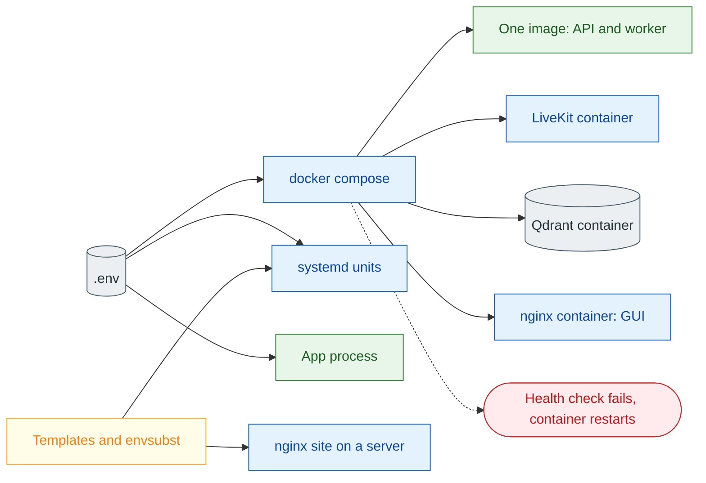

# 14 Infrastructure

**What this block is:** everything that packages and runs OmniVox outside your editor: the Docker image, Docker Compose, the nginx site, the systemd services and the Makefile. Files: `deployment/` and `Makefile`. **Assumes:** [01](01-system-map.md) (which processes exist) and [09](09-livekit.md) (the LiveKit server). **Task-oriented reference:** [deployment.md](../deployment.md).

## 1. The problem

Five processes (API, voice worker, LiveKit, GUI, Qdrant) with their own ports, keys and start order have to come up the same way on a laptop, in Docker and on a Linux server, whether Docker runs all of them or only LiveKit and Qdrant. The design rule is **one `.env`, many consumers**: Docker Compose, systemd and the app all read the same file, and templates are rendered with `envsubst` rather than hand-edited per machine.



## 2. The image: `deployment/Dockerfile`

<!-- excerpt: deployment/Dockerfile:L1-30 -->
```text
# deployment/Dockerfile
# syntax=docker/dockerfile:1
# One image for the API (python -m src.app) and the voice worker (python -m src.voice.worker start).
FROM ghcr.io/astral-sh/uv:0.12.13 AS uv

FROM python:3.12-slim AS builder
COPY --from=uv /uv /uvx /bin/
ENV UV_COMPILE_BYTECODE=1 \
    UV_LINK_MODE=copy \
    UV_PYTHON_DOWNLOADS=never
WORKDIR /app
COPY pyproject.toml uv.lock .python-version ./
RUN --mount=type=cache,target=/root/.cache/uv \
    uv sync --frozen --no-dev --no-install-project

FROM python:3.12-slim AS runtime
ARG PORT=8100
ENV PYTHONUNBUFFERED=1 \
    PATH="/app/.venv/bin:$PATH" \
    PORT=${PORT}
RUN useradd --create-home --uid 10001 app
WORKDIR /app
COPY --from=builder /app/.venv /app/.venv
COPY config ./config
COPY src ./src
RUN mkdir -p files/logs && chown -R app:app /app/files
USER app
EXPOSE ${PORT}
HEALTHCHECK --interval=30s --timeout=5s --start-period=40s --retries=3 \
    CMD ["python", "-c", "import os, urllib.request; urllib.request.urlopen('http://127.0.0.1:%s/health' % os.environ['PORT'], timeout=4)"]
CMD ["python", "-m", "src.app"]
```

What to notice:

- **Multi-stage.** The first stage uses `uv` (copied from the official pinned image) to install dependencies from `uv.lock` with `--frozen` (the lock file is law; the build fails instead of resolving newer versions). Only the finished virtual environment is copied to the final image, so build tools never ship.
- **One image, two programs.** The default command starts the API; the compose `agent` service overrides it to start the worker.
- **Non-root user and no secrets inside.** The image contains code and dependencies only; `.env` is supplied at run time.
- **A health check** that uses Python's standard library to call `/health` (slim images have no `curl`).
- The files copied are only `config/` and `src/`: tests, docs and the frontend stay out (`.dockerignore`).

## 3. Compose: `deployment/docker-compose.yml`

Compose has three **profiles**, so you start only what you need:

| Command | Starts |
| --- | --- |
| `make docker-up` (profile `app`) | LiveKit, Qdrant, API, agent |
| `make up` or `make docker-up-gui` (profile `gui`) | the same plus the GUI container: everything in Docker |
| `make docker-infra-up` (profile `infra`) | only LiveKit and Qdrant, for a host that runs the API and the worker under systemd |

The two YAML anchors at the top avoid repeating settings for the API and the agent:

<!-- excerpt: deployment/docker-compose.yml:L9-28 -->
```yaml
# deployment/docker-compose.yml
name: omnivox

x-app-env: &app-env
  LIVEKIT_URL: ws://livekit:7880
  QDRANT_URL: ${QDRANT_DOCKER_URL:-http://qdrant:6333/}
  LOG_DIR: /app/files/logs
  GRAPH_MEMORY_URL: /app/files/graph_memory.sqlite

x-app-service: &app-service
  build:
    context: ..
    dockerfile: deployment/Dockerfile
    args:
      PORT: ${PORT:-8100}
  image: omnivox:latest
  env_file: ../.env
  environment: *app-env
  volumes:
    - ../files:/app/files
  restart: unless-stopped
```

- `env_file: ../.env` loads the secrets; `environment:` then **overrides** the few values that differ inside Docker: `LIVEKIT_URL` must be `ws://livekit:7880` (the service name), and Qdrant is the bundled `qdrant` container. Set `QDRANT_DOCKER_URL` to use another Qdrant, for example `http://host.docker.internal:6333/` for one on your machine.
- The `qdrant` service keeps its data in the named volume `qdrant_data`, so `make down` and `make restart` never lose the knowledge base. It publishes `127.0.0.1:${QDRANT_HOST_PORT:-6333}` for the systemd setup; change `QDRANT_HOST_PORT` when 6333 is taken. Its health check is a bash TCP probe because the image has no `curl`.
- A bind mount `../files:/app/files` keeps logs and the optional SQLite memory outside the container.
- The LiveKit service gets its config from an environment variable ([block 09](09-livekit.md)); `node_ip` is the setting to remember when audio is silent.
- `depends_on` with `condition: service_healthy` makes the API and the worker wait for Qdrant. `restart: true` makes nginx restart whenever the API container is recreated (nginx resolves `api` once, so it would otherwise keep a stale address) and the worker restart whenever LiveKit is recreated.

### The worker shares LiveKit's network

LiveKit tells every client which address to send media to (`node_ip`). A browser on your machine needs `127.0.0.1`, but from inside a separate worker container `127.0.0.1` is the container itself, so media never arrives. The fix is one line:

<!-- excerpt: deployment/docker-compose.yml:L92-119 -->
```yaml
# deployment/docker-compose.yml
agent:
  <<: *app-service
  profiles: ["app", "gui"]
  command: ["python", "-m", "src.voice.worker", "start"]
  # The worker shares LiveKit's network namespace. LiveKit hands every client the media address
  # LIVEKIT_NODE_IP (127.0.0.1 by default), and from inside this namespace that address is the
  # LiveKit server itself, so media works with no extra configuration. `restart: true` below
  # recreates the worker whenever `livekit` is recreated, which a shared namespace requires.
  network_mode: "service:livekit"
  environment:
    <<: *app-env
    LIVEKIT_URL: ws://127.0.0.1:7880
  depends_on:
    livekit:
      condition: service_started
      restart: true
    qdrant:
      condition: service_healthy
  healthcheck:
    test:
      - CMD
      - python
      - -c
      - "import os, urllib.request; urllib.request.urlopen('http://127.0.0.1:%s/' % os.environ.get('WORKER_PORT', '8181'), timeout=4)"
    interval: 30s
    timeout: 5s
    start_period: 40s
    retries: 3
```

`network_mode: "service:livekit"` puts the worker in LiveKit's network namespace, where `127.0.0.1` **is** the LiveKit server. The browser and the worker both work with the same `node_ip`, and no LAN address has to be configured. The price: the worker has no network of its own, so `ports` and `extra_hosts` live on the `livekit` service, and the worker must be recreated when LiveKit is (`restart: true` does that).
- Compose itself reads `${VARS}` for interpolation from `--env-file .env`, which is why every Make target passes it.

## 4. nginx: `deployment/nginx/omnivox.conf.template`

On a real server nginx serves the GUI files and proxies the API. The file is a **template**: variables like `${SERVICE_NAME}` and `${API_UPSTREAM}` are filled in by `envsubst` with an explicit list of names, so nginx's own `$host` and `$uri` pass through untouched.

<!-- excerpt: deployment/nginx/omnivox.conf.template:L11-21 -->
```text
# deployment/nginx/omnivox.conf.template
# Upgrade requests keep their Upgrade header; plain requests send an empty Connection so the
# upstream keepalive pool is used. The variable is per service so several sites can coexist.
map $http_upgrade $${SERVICE_NAME}_connection {
    default upgrade;
    ""      "";
}

upstream ${SERVICE_NAME}_api {
    server ${API_UPSTREAM};
    keepalive 16;
}
```

That `map` gives every request a `Connection` header: `upgrade` for WebSocket upgrades and empty for ordinary requests so the upstream keep-alive pool works. The variable name includes the service, so two sites can coexist.

<!-- excerpt: deployment/nginx/omnivox.conf.template:L23-41 -->
```text
# deployment/nginx/omnivox.conf.template
server {
    listen 80;
    server_name ${SERVER_NAME};

    client_max_body_size ${CLIENT_MAX_BODY_SIZE};

    # Server-sent events and WebSocket upgrades must not be buffered.
    proxy_http_version 1.1;
    proxy_buffering off;
    proxy_cache off;
    proxy_read_timeout ${REQUEST_TIMEOUT}s;
    proxy_send_timeout ${REQUEST_TIMEOUT}s;
    proxy_set_header Host $host;
    proxy_set_header X-Real-IP $remote_addr;
    proxy_set_header X-Forwarded-For $proxy_add_x_forwarded_for;
    proxy_set_header X-Forwarded-Proto $scheme;
    proxy_set_header X-Request-ID $request_id;
    proxy_set_header Upgrade $http_upgrade;
    proxy_set_header Connection $${SERVICE_NAME}_connection;
```

The settings that matter for this app:

| Setting | Why |
| --- | --- |
| `proxy_buffering off` | otherwise SSE tokens arrive in bursts |
| `proxy_read_timeout ${REQUEST_TIMEOUT}s` | a long chat turn must not be cut by nginx |
| `proxy_http_version 1.1` | keep-alive to the upstream |
| `X-Forwarded-*`, `X-Request-ID` | the app logs real client addresses and a trace id |
| `client_max_body_size ${CLIENT_MAX_BODY_SIZE}` | allow document uploads |

Three ways to reach the app through one site: `/api/` and `/health` (host mode), `/${SERVICE_NAME}/` (path mode, strips the prefix) and `/` (the built GUI with a fallback to `index.html`). Browsers talk to **LiveKit directly**, not through nginx.

## 5. systemd

Each service is one small unit rendered from a template:

<!-- excerpt: deployment/systemd/omnivox.service.template:L1-21 -->
```text
# deployment/systemd/omnivox.service.template
# Rendered with envsubst limited to: SERVICE_NAME INSTALL_DIR RUN_USER
[Unit]
Description=${SERVICE_NAME} API (FastAPI)
After=network-online.target
Wants=network-online.target

[Service]
Type=simple
User=${RUN_USER}
WorkingDirectory=${INSTALL_DIR}
EnvironmentFile=${INSTALL_DIR}/.env
ExecStart=${INSTALL_DIR}/.venv/bin/python -m src.app
Restart=on-failure
RestartSec=5
NoNewPrivileges=true
PrivateTmp=true
ProtectSystem=strict
ReadWritePaths=${INSTALL_DIR}/files

[Install]
WantedBy=multi-user.target
```

`Restart=on-failure` revives a crashed process after five seconds. `NoNewPrivileges`, `PrivateTmp` and `ProtectSystem=strict` shrink what a compromised process could touch, and `ReadWritePaths` re-opens only the `files/` folder it needs. `EnvironmentFile` is the same `.env`, which is why `.env.example` must use plain `KEY=VALUE` lines (systemd parses quotes differently from Docker and Pydantic). The agent has an identical unit with a different `ExecStart`. Logs go to the journal (`make systemd-logs`).

### Two ways to combine systemd and Docker

| Setup | Commands | Who restarts what |
| --- | --- | --- |
| **Docker runs everything, systemd runs Docker** | `make systemd-docker-install` | `omnivox-docker.service` is a `Type=oneshot` unit with `RemainAfterExit=yes`: it runs `docker compose up -d` at boot and `down` on stop. Compose's own `restart: unless-stopped` revives crashed containers. |
| **Docker for LiveKit and Qdrant, systemd for the Python processes** | `make deploy-all` | `omnivox.service` and `omnivox-agent.service` restart on failure; the two infrastructure containers come back with Docker. |

The Docker unit needs `Requires=docker.service` and `After=docker.service`, a generous `TimeoutStartSec=900` (the first start builds the images) and a `RUN_USER` that is in the `docker` group. All three units were checked with `systemd-analyze verify` in a Debian container.

## 6. The Makefile

The Makefile is deliberately thin: each target is one or two commands you could type yourself (the Windows table in [installation.md](../installation.md) lists them). Its clever parts are small:

<!-- excerpt: Makefile:L7-22 -->
```text
# Makefile
env_value = $(shell sed -n 's/^$(1)=//p' .env 2>/dev/null | tail -n 1)

SERVICE_NAME ?= $(or $(call env_value,APP_NAME),omnivox)
PORT ?= $(or $(call env_value,PORT),8100)
REQUEST_TIMEOUT ?= $(or $(call env_value,REQUEST_TIMEOUT),60)
SERVER_NAME ?= _
INSTALL_DIR ?= $(CURDIR)
RUN_USER ?= $(shell id -un)
CLIENT_MAX_BODY_SIZE ?= 12m

COMPOSE := docker compose --env-file .env -f deployment/docker-compose.yml
UNITS := $(SERVICE_NAME).service $(SERVICE_NAME)-agent.service
SYSTEMD_DIR := /etc/systemd/system
NGINX_CONF := /etc/nginx/conf.d/$(SERVICE_NAME).conf
SYSTEMD_VARS := '$${SERVICE_NAME} $${INSTALL_DIR} $${RUN_USER}'
NGINX_VARS := '$${SERVICE_NAME} $${SERVER_NAME} $${API_UPSTREAM} $${FRONTEND_ROOT} $${REQUEST_TIMEOUT} $${CLIENT_MAX_BODY_SIZE}'
```

- **`env_value`** reads a single key out of `.env` with `sed`, so `make deploy-gui` knows `PORT` and `APP_NAME` without sourcing the whole file (which would break on values containing `#` or spaces).
- Variables use `?=`, so `make deploy-gui SERVER_NAME=ai.example.com` overrides them.
- **`SYSTEMD_VARS` and `NGINX_VARS`** are the exact lists handed to `envsubst`. Limiting the list is what protects nginx's `$host`.

`make help` is generated from the `##` comments on each target line, so adding a target with a comment documents it automatically; `tests/test_docs.py` also insists every target appears in `docs/deployment.md`.

<!-- excerpt: Makefile:L32-33 -->
```text
# Makefile
help: ## Show this help
	@awk 'BEGIN {FS = ":.*## "} /^##@/ {printf "\n%s\n", substr($$0, 5)} /^[a-zA-Z0-9_-]+:.*## / {printf "  %-24s %s\n", $$1, $$2}' $(MAKEFILE_LIST)
```

Deploy targets are idempotent: they overwrite the rendered files, reload the daemon, test nginx with `nginx -t` **before** reloading it, and can be run again safely.

## 7. Mistakes that happened here

| What happened | Cause | Fix |
| --- | --- | --- |
| `make` unavailable | not installed on Windows | the Makefile is validated inside an `alpine` container; docs list direct commands |
| nginx variable `$host` vanished from a rendered file | `envsubst` replaced every `$...` | explicit variable list |
| nginx `map` variable clashed between two sites | a fixed variable name | `$${SERVICE_NAME}_connection` |
| Agent in Docker could not reach media | `node_ip` was `127.0.0.1`, unreachable from a container | the worker joins LiveKit's network namespace (`network_mode: service:livekit`) |
| Frontend returned 502 after the API was rebuilt | nginx kept the old IP of the `api` container | `depends_on` with `restart: true` |
| Bundled Qdrant failed to start | an existing Qdrant already used host port 6333 | `QDRANT_HOST_PORT=6335` in `.env` |
| The model said "Let me check" and stopped | a small model ended its turn after the filler phrase instead of calling the tool | prompt 1.1 plus a model that calls tools reliably (see [llm.md](../llm.md)) |
| An old container kept running after tests | compose project left up | stop with `make docker-down` after experiments |

## Try it

```bash
docker compose --env-file .env -f deployment/docker-compose.yml --profile gui config -q && echo "compose file is valid"
docker run --rm -v "$PWD:/w" -w /w alpine:3.20 sh -c "apk add -q make gawk && make help"
```

The first validates the compose file with your `.env`. The second runs `make help` inside Linux, which is also how this Makefile was tested without installing `make`. To see the nginx template rendered, run `envsubst` with the same variable list as `NGINX_VARS` on the file and `nginx -t` it in an `nginx:alpine` container.

## Modify it

- **Another service** (say Redis) in compose: add a service with `profiles`, a volume and a health check, as `qdrant` does, and a `depends_on` with `service_healthy` on the services that need it.
- **Run the API and the worker under systemd but keep LiveKit and Qdrant in Docker:** `make docker-infra-up`, then `make deploy-app`.
- **A different port:** change `PORT` in `.env`; the Dockerfile, compose ports, health check and nginx upstream all follow it.

## Check yourself

- Why does the compose file override `LIVEKIT_URL` even though `.env` already has one?
- What would break if the nginx site used `proxy_buffering on`?
- Why is the `envsubst` variable list explicit instead of "all variables"?
- Which setting do you change when a containerized agent connects but the caller hears nothing?
- Why does the worker use `network_mode: "service:livekit"` instead of the `livekit` hostname for media?
- What survives `make restart`, and what survives `docker compose down -v`?

## Read next

Back to the [map](README.md), or [01 System map](01-system-map.md) to see where infrastructure fits.
