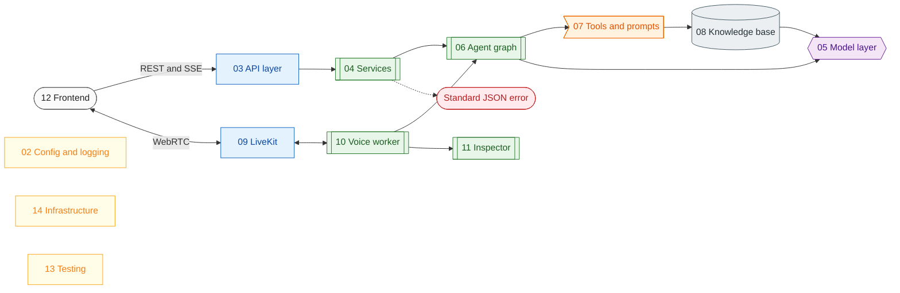

# OmniVox study guide: one page per block

OmniVox is a voice agent made of a few independent blocks. Each page below explains one block **on its own**: what problem it solves, how it works, the real code, the mistakes that were made while building it, and exercises. You can read them in order or jump to the block you care about. Every page starts with the pages it assumes, so you never need to read the others first.

Legend: stadium = client or response, rectangle = server or config, subroutine = code block, hexagon = model, flag = tool, cylinder = storage, rhombus = cross-cutting, dashed line = error path. Block 01 is the map that connects them all.

## The pages

| Page | Block | Read it to learn |
| --- | --- | --- |
| [01 System map](01-system-map.md) | the whole system | which processes exist, one text turn and one voice turn end to end, where time goes |
| [02 Configuration and logging](02-configuration-and-logging.md) | `config/` | how settings are validated, how secrets stay secret, how logs are formatted and redacted |
| [03 API layer](03-api-layer.md) | `src/app.py`, `src/api/` | middleware order, request ids, the error envelope, dependency wiring, streaming responses |
| [04 Services](04-services.md) | `src/services/` | use-case logic without a web framework: chat, knowledge base, LiveKit tokens |
| [05 Model layer](05-model-layer.md) | `src/ai_models/` | LLM, embeddings, STT, TTS, VAD and turn detection clients; thinking switch; Gemini quirks |
| [06 Agent graph](06-agent-graph.md) | `src/graph/` | a LangGraph primer, then our agent, router, tool node, memory and streaming |
| [07 Tools and prompts](07-tools-and-prompts.md) | `src/graph/tools/`, `src/prompts/` | how the model calls tools, prompt-injection hygiene, adding a tool |
| [08 Knowledge base](08-knowledge-base-rag.md) | `src/rag/`, `src/clients/qdrant.py` | chunking, embeddings, vector search, scores, tuning |
| [09 LiveKit](09-livekit.md) | LiveKit server and SDKs | rooms, tracks, tokens, data packets, agent dispatch, and how OmniVox uses them |
| [10 Voice worker](10-voice-worker.md) | `src/voice/` | the pipeline of one call: VAD, STT, end of turn, graph, TTS, interruptions |
| [11 Inspector](11-inspector.md) | `src/voice/inspector.py`, `src/graph/trace.py` | how internal steps become events, and how to add one |
| [12 Frontend](12-frontend.md) | `frontend/` | provider tree, API client, SSE parser, LiveKit hooks, the Inspector store |
| [13 Testing](13-testing.md) | `tests/`, `scripts/` | offline fakes, fixtures, drift tests, live checks |
| [14 Infrastructure](14-infrastructure.md) | `deployment/`, `Makefile` | Docker image, compose, nginx, systemd, make |

## How to study

1. **Follow one request.** Read 01, then 03, 04, 06 and 05 in that order: a text message travels exactly that path.
2. **Follow one call.** Read 09, 10 and 11: a voice turn travels that path. 12 shows what the browser does with it.
3. **Break something on purpose.** Each page ends with a "Try it" and a "Check yourself" section. The exercises name the file to change and what you should see.
4. **Trust the code, not the prose.** Every code excerpt in these pages is copied verbatim from the source, and `tests/test_docs.py` fails when one no longer matches. After you change code that a page quotes, run `uv run python scripts/refresh_block_excerpts.py`: it rewrites the excerpts in place and leaves the prose alone. Prose can lag; excerpts cannot.

## Glossary

| Term | Meaning |
| --- | --- |
| VAD | Voice activity detection: decides frame by frame whether someone is speaking. |
| STT / ASR | Speech to text. Streaming STT returns partial ("interim") transcripts while you talk. |
| TTS | Text to speech. |
| End of turn (EOT) | Deciding the user has finished their thought, not just paused. |
| Barge-in | The user speaking over the agent, which interrupts the reply. |
| LLM | The language model that decides what to say and which tools to call. |
| Tool call | The model asking the program to run a named function with arguments. |
| RAG | Retrieval-augmented generation: look up relevant text, then answer from it. |
| Embedding | A vector of numbers that represents the meaning of a text; similar texts have close vectors. |
| Chunk | A piece of a document sized for embedding and retrieval. |
| Cosine similarity | The score used to compare two embeddings (1 is identical, 0 unrelated). |
| SSE | Server-sent events: a long HTTP response that streams `event:` and `data:` frames. |
| Room, participant, track | LiveKit: a meeting space, someone in it (a browser or the agent), and an audio or video stream they publish. |
| Data packet | A small message sent through a LiveKit room next to the audio; the Inspector uses them. |
| Dispatch | LiveKit sending a new room to an available agent worker. |
| Composition root | The one place that creates and connects the objects of a program. |
| Checkpointer | LangGraph's store for conversation state per `thread_id`. |
| Thought signature | A token Gemini 3 returns with a tool call and expects back on the next request. |
