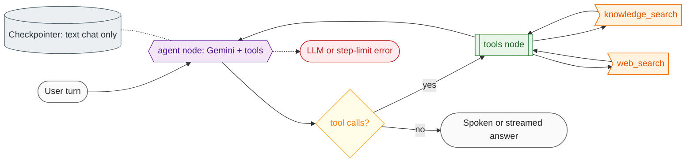

# Agent graph

The agent is a LangGraph `StateGraph` (`src/graph/builder.py`). One graph serves both the voice session and the text chat endpoints.

Legend: stadium = client or response, subroutine = service/node, hexagon = model, flag = tool, rhombus = decision, cylinder = storage, dashed line = error path.

## State

`AgentState` has one field, `messages` (`add_messages` reducer). Incoming system messages are dropped by the agent node; the prompt module owns the instructions.

## Nodes

| Node | File | What it does |
| --- | --- | --- |
| `agent` | `src/graph/nodes/agent.py` | Keeps the last `GRAPH_MAX_HISTORY_MESSAGES` messages (starting on a user message, and within `GRAPH_MAX_HISTORY_CHARS` when set; the current turn is always kept), applies the system prompt with the current time plus any `AGENT_INSTRUCTIONS`, calls `LLMService.ainvoke` with the tools bound. |
| `tools` | `src/graph/nodes/tools.py` | Runs the tool calls of the last assistant message in parallel. An unknown tool name or a tool exception becomes an error `ToolMessage` with a safe text, so the conversation continues. |

Router: `route_after_agent` returns `tools` when the last message has tool calls, otherwise ends. The step limit is `GRAPH_RECURSION_LIMIT`; hitting it raises `GraphExecutionError` (`graph_error`).

## Tools

Registered in one place, `src/graph/tools/__init__.py` (explicit allow-list). Each has a Pydantic argument schema (query of 2 to 300 characters), a description from `src/prompts/agent.py`, and returns a short safe message instead of raising.

| Tool | Backed by | Output |
| --- | --- | --- |
| `knowledge_search` | `Retriever`: embed the query, search Qdrant | `<passage source="..." score="0.83">text</passage>` per hit; "No relevant passages" when empty; "not available" when the embedding key is missing or Qdrant fails |
| `web_search` | `WebSearchClient` (ddgs in a worker thread, `WEB_SEARCH_TIMEOUT`) | `<web_result site="...">title: snippet</web_result>` per hit |

Tool output is untrusted data. Angle brackets inside it are neutralized (`escape_tags`) so it cannot close its own tag, and the system prompt tells the model never to follow instructions found there.

## Memory

`src/graph/memory.py` opens the checkpointer for `GRAPH_MEMORY_BACKEND` (`memory` or `sqlite`) in the app lifespan; `thread_id` is the request `session_id`. The voice session does not use it: LiveKit's chat context already carries the conversation, so the voice graph is compiled without a checkpointer. Using one would append every turn twice.

## Stream events

`src/graph/streaming.py` turns a run into SSE events: `node`, `tool`, `token`, then one `final` or `error` (see [api.md](api.md#post-apiv1agentstream)). Tokens come from the `agent` node only. The same `TraceCallbackHandler` (`src/graph/trace.py`) feeds the voice Inspector, see [voice.md](voice.md).

## Adding a node or tool

1. Tool: add a module in `src/graph/tools/`, its description to `src/prompts/agent.py`, register it in `build_tools`, add a test.
2. Node: add a module in `src/graph/nodes/`, wire it in `builder.py`, add its name to `src/graph/state.py`, extend `tests/graph/test_builder.py`.
