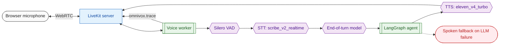

# Voice pipeline and Inspector



Legend: stadium = client, rectangle = server, subroutine = process, hexagon = model, dashed = error path.

## How a call works

1. The GUI asks `POST /api/v1/livekit/token` for a token with a new room name and joins that room.
2. LiveKit sees a new room and dispatches the voice worker (`src/voice/worker.py`, automatic dispatch because the worker has no agent name).
3. The worker builds the shared runtime (`src/composition.py`), connects, starts the Inspector and an `AgentSession`, and speaks `AGENT_GREETING`.
4. Per turn: Silero VAD detects speech, the STT model streams transcripts, the end-of-turn model decides when the user is done, the LangChain adapter runs the graph and streams its tokens, and the TTS model speaks them. Tool calls happen inside the graph, so the model's short "Let me check" is spoken before a search starts. `SpeakableGraph` (`src/voice/speakable.py`) sits between the graph and the adapter and forwards only the agent node's assistant text: LiveKit's adapter would otherwise read the finished tool results (raw search output) aloud.
5. When the user speaks over the agent, VAD interrupts the reply (`ALLOW_INTERRUPTIONS`).

## Models

| Stage | Setting | Default | Notes |
| --- | --- | --- | --- |
| VAD | `VAD_*` | Silero, local CPU | Loaded once per worker process in `prewarm`. |
| STT | `STT_PROVIDER`, `STT_MODEL` | `elevenlabs`, `scribe_v2_realtime` | `openai` targets any `/v1/audio/transcriptions` server through `STT_BASE_URL`. |
| End of turn | `TURN_DETECTOR` | `audio` | LiveKit's local `v1-mini` audio model, no LiveKit account needed. `vad` uses silence only, `stt` uses the STT's own endpointing. |
| LLM | `OPENAI_*` | `gemini-3-flash-preview` | Through the graph, see [llm.md](llm.md). |
| TTS | `TTS_PROVIDER`, `TTS_MODEL`, `TTS_VOICE` | `elevenlabs`, `eleven_v4_turbo` | `openai` targets any `/v1/audio/speech` server through `TTS_BASE_URL`. |

Switching to self-hosted models is an `.env` change, for example `STT_PROVIDER=openai`, `STT_BASE_URL=http://localhost:8001/v1`, `STT_MODEL=openai/whisper-large-v3`.

Interruption detection uses VAD (`mode: vad`) because LiveKit's adaptive interruption model needs LiveKit Inference credentials. `PREEMPTIVE_GENERATION` is off so a tool call is not repeated when a turn is revised.

## Inspector

When `INSPECTOR_ENABLED` is true the worker publishes JSON events on the LiveKit data topic `omnivox.trace` (reliable). The GUI renders them as a per-turn timeline. Wire format (`src/utils/trace_events.py`):

```json
{"v": 1, "id": "a1b2c3d4e5f6", "ts": 1793521890587, "turn": 2, "source": "tool", "type": "end",
 "label": "Tool web_search returned", "duration_ms": 3120.4,
 "data": {"name": "web_search", "result_preview": "<web_result ..."}}
```

`turn` increments when the user starts speaking and stays the same until the agent has finished talking, so a pause inside one question is one turn. Text values are cut to `INSPECTOR_MAX_FIELD_CHARS`; an event that would exceed one data packet (about 14 KB) is sent without its data and `{"truncated": true}`.

| Source.type | Data |
| --- | --- |
| `session.connected` | `room`, `models` (kind to provider/model) |
| `session.agent_state` | `state` (initializing, idle, listening, thinking, speaking), `previous` |
| `session.message` | `role`, `text` |
| `session.closed` | `reason` |
| `vad.user_state` | `state` (speaking, listening, away), `previous` |
| `vad.false_interruption` | none |
| `stt.interim`, `stt.final` | `text`, `language` (final only) |
| `eot.detected` | `delay_ms`, `transcript_delay_ms` |
| `graph.node_start`, `graph.node_end` | `node` (`duration_ms` on end) |
| `graph.route` | `from`, `to` |
| `llm.start` | `model`, `messages` |
| `llm.first_token` | `ttft_ms` |
| `llm.end` | `input_tokens`, `output_tokens`, `finish_reason`, `tool_calls` |
| `tool.start` | `name`, `args` |
| `tool.end` | `name`, `result_preview` (`duration_ms`) |
| `tool.error` | `name`, `message` |
| `graph.node_cancelled`, `llm.cancelled`, `tool.cancelled` | `node` or `name`: the run was cut short because the caller spoke again |
| `tts.first_audio` | `ttfb_ms` |
| `latency.turn_summary` | `eot_ms`, `llm_ttft_ms`, `tts_ttfb_ms`, `total_ms`, `playback_ms` |
| `error.error` | `message`, `source` (plus `recoverable` for session errors) |

The latency fields come from LiveKit's per-message metrics: `eot_ms` (also reported as `eot.detected`) is the wait after speech ended, read from the user's message; `total_ms` is speech end to the start of the reply. The agent's greeting has no user turn, so it reports `tts.first_audio` but no summary. Unmeasured values are `null`. The GUI treats unknown sources and types gracefully, so new events need no GUI change.

Server logs never contain transcripts or prompts above DEBUG; the Inspector is the place to read them, and only the connected participants of that room receive them.

## Tuning

| Symptom | Setting |
| --- | --- |
| Agent answers too soon, cutting off the user | raise `MIN_ENDPOINTING_DELAY`, or `VAD_MIN_SILENCE_DURATION` |
| Long dead air before answers | lower `MIN_ENDPOINTING_DELAY` / `MAX_ENDPOINTING_DELAY`; use `OPENAI_REASONING_EFFORT=minimal` (Gemini) or `OPENAI_ENABLE_THINKING=false` (Qwen, Gemma and other open-source models) |
| Background noise triggers speech | raise `VAD_ACTIVATION_THRESHOLD` |
| Agent talks over itself | `ALLOW_INTERRUPTIONS=false` |

## Tracing

With `TRACING_PROVIDER=langsmith` the graph run (LLM calls, tools) is traced through the callback and each reply's latency summary is recorded as a `voice.turn` run, so STT, LLM and TTS timing sit next to the trace.
